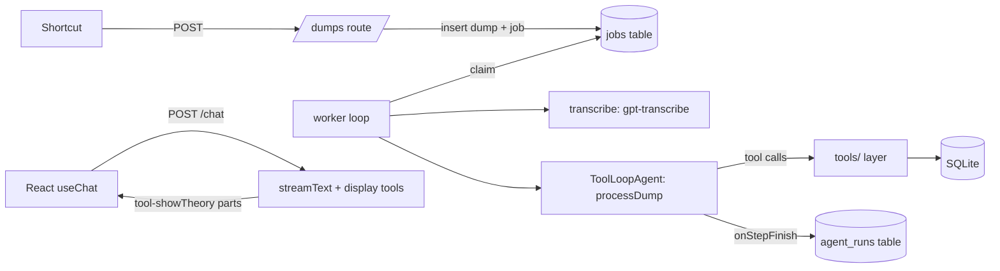

# Agent architecture research: Aber

Researched 31 Oct 2026. Every version number, date and price below was checked against an official page, npm or GitHub on that day unless marked otherwise. Confidence: **high** = read on an official source; **moderate** = official source plus some inference; **low** = secondary sources or my judgement.

**Short answer:** use the **Vercel AI SDK 7** (the open-source `ai` library, not the Vercel platform) inside the Hono server, with a **small jobs table in Aber's own SQLite** for background work, and **Vitest fixture tests** for evals. OpenAI models by default, Claude swappable per job. Confidence: moderate–high. Details in [section 4](#4-recommendation).

---

## 1. Primer: what these words mean for Aber

| Term | Plain meaning | In Aber |
| --- | --- | --- |
| **Model call** | Send text to an LLM, get text back | "Here's a transcript, what's in it?" |
| **Tool** | A function you describe to the model (name, description, typed inputs). The model can ask to call it; *your* code runs it and sends back the result | `createSignal`, `fileSignalIntoTheme`, `proposeEvidence`, `searchThemes`. These are exactly Aber's typed tool layer, so agents never touch SQLite directly |
| **Agent loop** | Call the model; if it asks for tools, run them, append the results, call again; stop when it answers or hits a step limit | "Process a dump" is one loop: read dump, search themes, create signals, file them, propose evidence, stop |
| **Structured output** | Force the model's answer into a schema (e.g. Zod) so you get a typed object, not prose | Splitting a dump into `{ signals: [{ gist, sourceUrl, quote }] }` |
| **Agent framework** | A library that gives you the loop, tool definitions, provider switching, streaming and logging so you don't hand-write them | AI SDK, OpenAI Agents SDK, pi, Mastra, LangGraph |
| **Provider** | Which company's model you call | OpenAI, Anthropic. A good framework lets you change one line to switch |
| **Streaming** | Send the answer to the browser as it's produced | The "dump or ask" chat |
| **Generative UI** | The model calls a "display" tool; the browser renders a real React component for that tool's result instead of text | Agent replies with a `<TheoryCard>` or `<SignalList>` instead of a paragraph |
| **Durable job** | Background work saved in a database so it survives crashes and restarts and is retried if it fails | "Process this dump" queued when the Shortcut posts; overnight clustering |
| **Tracing** | A record of each run: prompts, tool calls, outputs, tokens, cost, time | The design model already needs "processing runs (agent, model, version)" per dump |
| **Evals** | Tests for prompts: fixed inputs, checks on outputs (exact rules, or a second model grading) | "This 3-link voice note should give 3–5 signals, all filed into existing themes" |

---

## 2. What exists (Oct 2026)

### 2a. Agent frameworks

| | **Vercel AI SDK 7** | **OpenAI Agents SDK (JS)** | **pi** (Mario Zechner) | **Mastra** | **LangGraph.js** |
| --- | --- | --- | --- | --- | --- |
| Package, version, date | `ai` 7.0.159, 30 Oct 2026 ([npm](https://www.npmjs.com/package/ai)) | `@openai/agents` 0.21.0, 20 Oct 2026 ([npm](https://www.npmjs.com/package/@openai/agents)) | `@earendil-works/pi-ai`, `pi-agent-core` 1.4.0, 21 Oct 2026 ([repo](https://github.com/earendil-works/pi)) | `@mastra/core` 1.81.0, 30 Oct 2026 ([npm](https://www.npmjs.com/package/@mastra/core)) | `@langchain/langgraph` 1.6.0, 30 Oct 2026 ([npm](https://www.npmjs.com/package/@langchain/langgraph)) |
| What it is | Library: model calls, tools, structured output, `ToolLoopAgent`, React chat hooks | OpenAI's agent runtime: agents, handoffs, guardrails, sessions, tracing | Minimal toolkit: unified LLM API (`pi-ai`) plus a small stateful agent loop (`pi-agent-core`). Powers the pi coding agent | Batteries-included framework on top of AI SDK models: agents, workflows, memory, evals, dev studio | Graph/state-machine agent runtime from LangChain |
| Multi-provider | Yes, first-class: `@ai-sdk/openai`, `@ai-sdk/anthropic` and many more. **High** | OpenAI native; others via the AI SDK adapter, which the docs call **"still in beta"** and which loses some OpenAI-only features ([docs](https://openai.github.io/openai-agents-js/extensions/ai-sdk/)). **High** | Yes, ~35 providers incl. OpenAI, Anthropic, any OpenAI-compatible API ([README](https://github.com/earendil-works/pi/tree/main/packages/ai)). **High** | Yes (model router over AI SDK providers). **Moderate** | Yes, via LangChain model packages. **Moderate** |
| Runs on Coolify/Docker, no lock-in | Yes. Works in Hono ([cookbook](https://ai-sdk.dev/cookbook/api-servers/hono)). **Gotcha:** a bare string model id like `"openai/gpt-6-luna"` routes through Vercel AI Gateway by default ([docs](https://ai-sdk.dev/docs/ai-sdk-core/provider-management)); pass provider instances (`openai('gpt-6-luna')`) instead. **High** | Yes, plain Node. **High** | Yes, plain Node. **High** | Yes: Node 22.13+, Bun, containers; mounts inside an existing Hono app via `@mastra/hono` ([docs](https://mastra.ai/reference/server/hono-adapter)). **High** | Yes (self-host); LangGraph Platform is optional. **Moderate** |
| Tool schemas | Zod (or JSON Schema) | Zod | TypeBox, not Zod ([README](https://github.com/earendil-works/pi/tree/main/packages/ai)) | Zod | Zod |
| Streaming generative UI to React | **Best in class.** `useChat` renders typed `tool-<name>` parts with states such as `output-available` ([docs](https://ai-sdk.dev/docs/ai-sdk-ui/generative-user-interfaces)). RSC variant is experimental, not for production ([docs](https://ai-sdk.dev/docs/ai-sdk-rsc/overview)) | Via a bridge: `createAiSdkUiMessageStreamResponse` in `@openai/agents-extensions/ai-sdk-ui` feeds AI SDK's `useChat` (per [assistant-ui](https://www.assistant-ui.com/docs/integrations/frameworks/openai-agents)). **Moderate** | None for React in the current package list; you'd write the stream-to-UI glue. **Moderate** | Yes, streams into AI SDK UI. **Moderate** | Yes, own React hooks/AG-UI. **Low** |
| Durable background runs | `WorkflowAgent` in `@ai-sdk/workflow` (new in v7). Off Vercel it needs the **Postgres World**; the Local World "is intended for development" and has no SQLite option ([docs](https://workflow-sdk.dev/docs/configuration/worlds)). **High** | None built in; you bring a queue. Sessions are memory, OpenAI-hosted, or your own class ([docs](https://openai.github.io/openai-agents-js/guides/sessions/)). **High** | `pi-durable` with a SQLite backend and crash-resume, but labelled **"Experimental. The API changes without notice"** ([README](https://github.com/earendil-works/pi/tree/main/packages/durable)). **High** | Workflows with suspend/resume persisted to LibSQL/Postgres. **High** | Checkpointers incl. SQLite (`@langchain/langgraph-checkpoint-sqlite` 1.1.0). **High** |
| Tracing | OpenTelemetry via `@ai-sdk/otel`; lifecycle callbacks you can log yourself ([changelog](https://vercel.com/changelog/ai-sdk-7)). Sends nothing anywhere by default. **High** | **On by default in Node and exports to OpenAI's dashboard**, inputs and outputs included. Turn off with `OPENAI_AGENTS_DISABLE_TRACING=1` or `setTracingDisabled(true)`, or replace with `setTraceProcessors()` ([docs](https://openai.github.io/openai-agents-js/guides/tracing/)). **High** | Events stream (`agent_start`, `tool_execution_end`…) and per-call cost in `usage.cost`. **High** | Built-in tracing into its storage plus studio UI. **Moderate** | LangSmith-oriented. **Moderate** |
| Evals | None built in (use Vitest/promptfoo) | None in the JS SDK (OpenAI's hosted evals are separate) | None | `@mastra/evals` scorers, `runEvals` ([docs](https://mastra.ai/docs/evals/overview)). **Moderate** | LangSmith |
| Licence | Apache-2.0 | MIT | MIT core; Earendil plans Fair Source or proprietary add-ons ([news](https://www.pi-map.org/news/pi-joins-earendil/)). **Moderate** | Apache-2.0 core; `ee/` folders source-available, need a licence in production. **Moderate** | MIT |
| Maturity, activity | 27.7k stars, daily releases, v7 since 25 Jun 2026 | 4k stars, still 0.x, active | 119k stars (driven by the coding agent); moved from `badlogic/pi-mono` to `earendil-works/pi` and the `@earendil-works` npm scope in Apr–May 2026 ([Ronacher](https://mitsuhiko.spicytakes.org/post/2026-04-08-mario-and-earendil)). Old `@mariozechner/*` packages stopped at 0.73.1 | 29k stars, 1.x since Jan 2026, very active | 3.4k stars, 1.x, active |
| Simplicity for Aber | High: one library, plain functions | High for the loop; extra concepts (handoffs, guardrails) Aber doesn't need yet | Highest for the loop itself; lowest for everything around it | Medium: lots of framework (server, studio, storage, memory) to learn | Low: graph model is overkill here |

Stars and last-push dates from the GitHub API on 31 Oct 2026.

**About pi, plainly** (confidence high on facts, moderate on judgement):

- It's two layers you can use without the coding agent: `pi-ai` (one API over many providers, streaming events, cost per call) and `pi-agent-core` (an `Agent` class with `prompt()`, `steer()`, `abort()`, `beforeToolCall`/`afterToolCall` hooks, parallel tool execution) ([README](https://github.com/earendil-works/pi/tree/main/packages/agent)).
- It is deliberately small and has no persistence API: "Persistence is left to the app". That suits Aber's own tool layer.
- Against it for Aber: TypeBox instead of Zod (a second schema library if the rest of the app uses Zod), no React UI helpers, and the durable package is experimental. It is now company-backed by Earendil (Armin Ronacher's company), which adds staying power but also a mixed licensing future for add-ons.
- AI SDK 7 can *wrap* pi as a "harness" (`HarnessAgent`) ([changelog](https://vercel.com/changelog/ai-sdk-7)), but that's for coding agents, not Aber's jobs.

### 2b. Other options worth knowing

| Option | What | Fit for Aber |
| --- | --- | --- |
| [Vercel eve](https://vercel.com/blog/introducing-eve) | Durable agent framework on AI SDK + Workflow SDK, launched Jun 2026, still beta/RC | Self-hostable but "the second path"; durability wants Postgres. Too much. **Moderate** |
| [Cloudflare Agents](https://developers.cloudflare.com/agents/) (`agents` 0.32.0) | Each agent is a Durable Object | **Locked to Cloudflare.** Rule out. **High** |
| Effect AI (`@effect/ai` 0.37.0, Jul 2026) | Typed AI layer for the Effect ecosystem | Only if Aber adopts Effect wholesale. Steep learning curve. **Low** |
| [BAML](https://github.com/BoundaryML/baml) (0.226.3, Apache-2.0) | A small language for prompts plus forgiving parsing of model output, generates TS clients | Strong for extraction, but a second language and codegen step. Modern models' native structured outputs make it less necessary. Revisit only if splitting quality disappoints. **Moderate** |

### 2c. Background jobs on our own server

| Option | Storage | Retries, cron | Extra containers | Fit |
| --- | --- | --- | --- | --- |
| **Own `jobs` table in Aber's SQLite** (~150 lines) | Same DB, backed up by Litestream | You write: attempts, backoff, `run_at`; cron via a timer | None | **Best fit.** One user, one container, a few jobs a day |
| [liteque](https://github.com/karakeep-app/liteque) 0.10.0 | SQLite (Drizzle) | Retries, concurrency, timeouts, Zod validation; no cron or backoff mentioned | None | Good if you'd rather not write it; small project (80 stars) but used by Karakeep. **Moderate** |
| [bunqueue](https://github.com/egeominotti/bunqueue) 2.9.21 | SQLite or memory | Backoff, cron, priorities, dead-letter | None, but server mode needs **Bun** | Only if the server runs on Bun. **Moderate** |
| [Inngest](https://www.inngest.com/docs/self-hosting) self-hosted | Single binary; SQLite by default, in-process Redis | Excellent: step retries, cron, dashboard | One more container | Nice dashboard, but **SSPL licence** (Apache-2.0 later) and no support for self-hosting. **High** |
| [Trigger.dev](https://trigger.dev/docs/self-hosting/overview) self-hosted (Apache-2.0) | Postgres, Redis and more | Excellent | Several; "checkpoints" are Cloud-only | Overkill. **High** |
| Workflow DevKit + Postgres World | Postgres + graphile-worker | Step retries (3 by default) | Postgres | Conflicts with "no Postgres for v1". **High** |
| Temporal | Own cluster | Excellent | Many | Overkill. **High** |
| pg-boss / Graphile Worker | Postgres only | Good | Postgres | Not for SQLite. **High** |

### 2d. Light evals

| Option | What | Fit |
| --- | --- | --- |
| **Vitest + fixtures** | 10–20 real dumps saved as files; assert counts, schema validity, filing into the right theme; optionally a cheap model grades "is each gist one observation?" | **Start here.** Same test runner as the app |
| [vitest-evals](https://github.com/getsentry/vitest-evals) 0.17.0 (Sentry, Apache-2.0) | Eval helpers and scorers on top of Vitest | Good next step. **Moderate** |
| [promptfoo](https://github.com/promptfoo/promptfoo) 0.125.1 (MIT) | YAML test matrices, model-vs-model comparisons, red-teaming. Now owned by OpenAI, which says it stays open source ([OpenAI on X](https://x.com/OpenAI/status/2031052793835106753)) | Useful for "Luna or Haiku for splitting?" comparisons. **High** |
| `@mastra/evals` | Scorers tied to Mastra agents | Only if using Mastra |
| [autoevals](https://github.com/braintrustdata/autoevals) (MIT) | Braintrust's open-source scorer functions, usable without Braintrust | Borrow scorers. **Moderate** |
| [Langfuse](https://langfuse.com/self-hosting) self-hosted (MIT core, now ClickHouse-owned) | Tracing + evals UI | Needs Postgres, ClickHouse, Redis and S3. Too heavy for one user. **High** |
| Evalite | Vitest-based eval runner | Last release Nov 2025 (1.0 beta). Quiet. **High** |

---

## 3. Three architectures

All three share the same skeleton. Only the box marked ★ changes.

```
iPhone Shortcut ──POST /dumps──┐
React (Vite) ── /chat (stream) ┤
                               ▼
                    ┌──────── Hono server (one Docker container on Coolify) ───────┐
                    │  routes ─► tools/  (typed tool layer, Zod schemas, actor on   │
                    │             │       every write, authority rule enforced)     │
                    │             ▼                                                 │
                    │           db/ ── SQLite (WAL) ── Litestream ──► S3/backup     │
                    │             ▲                                                 │
                    │  worker ─► jobs table ─► ★ agent runtime ─► OpenAI / Anthropic │
                    └───────────────────────────────────────────────────────────────┘
```

### A. AI SDK 7 everywhere + own SQLite queue (recommended)



| Lives in | Code |
| --- | --- |
| `server/tools/` | Each tool once: Zod input, `execute` calling `db/` with `actor = {agent, model, runId}`. Exported both as plain functions (for routes and tests) and as AI SDK `tool()` objects |
| `server/agents/` | One file per job: instructions, which tools, which model, step limit, output schema |
| `server/jobs/` | `jobs` table, `enqueue()`, a `setInterval` worker that claims jobs in a transaction, retries with backoff, and a nightly scheduler |
| `server/routes/chat.ts` | `streamText` with read tools plus "display" tools, returned as a UI message stream |
| `web/chat/` | `useChat` from `@ai-sdk/react`; a `switch` on `part.type` maps `tool-showTheory` → `<TheoryCard>` from the component library |
| `evals/` | Vitest fixture tests |

| Pros | Cons |
| --- | --- |
| One library for jobs and chat; Zod everywhere | Durability is yours: a crashed run is retried from the start, so tool writes must be idempotent (tag writes with `runId`; on retry discard that run's drafts first) |
| Best React generative-UI support | AI SDK's Gateway default for string model ids must be avoided (use provider instances) |
| OpenAI and Claude are a one-line swap per job | Fast-moving: v6 → v7 in 6 months, with a codemod; expect another major in 2027 |
| No extra infrastructure; jobs are backed up with the data | No built-in run dashboard; you build a small `agent_runs` view or just query SQLite |

### B. OpenAI Agents SDK for jobs + AI SDK UI for chat

```mermaid
flowchart LR
  W[worker loop] --> AG[@openai/agents Runner]
  AG -->|OpenAI models native| O[OpenAI]
  AG -->|aisdk adapter, beta| AN[Anthropic]
  AG --> TL[tools/ layer]
  UI[React useChat] --> CR[/chat route/]
  CR --> AG2[Agent run stream] -->|createAiSdkUiMessageStreamResponse| UI
```

| Pros | Cons |
| --- | --- |
| Closest to OpenAI's models and newest features (e.g. tool search, compaction) | Claude goes through a beta adapter that drops some features |
| Handoffs and guardrails are there if jobs grow into multi-agent work | Two libraries to learn (Agents SDK + AI SDK UI) |
| Good built-in tracing UI on OpenAI | That tracing sends prompts and outputs to OpenAI by default; you must remember to turn it off or redirect it |
| | Still 0.x |

### C. pi (`pi-ai` + `pi-agent-core`) + own queue

| Pros | Cons |
| --- | --- |
| Smallest, most legible loop; good if Maggie wants to understand every line | TypeBox tools vs Zod elsewhere, or two schema libraries |
| Excellent provider coverage and per-call cost reporting | No React chat/generative-UI helpers; you'd write the streaming protocol and client state yourself |
| `pi-durable` (SQLite) could later replace the hand-made queue | `pi-durable` is experimental; core is MIT but add-on licensing is shifting |
| | Least documentation and fewest examples for web apps (its centre of gravity is the coding agent) |

### Not chosen

| Option | Why not (for now) |
| --- | --- |
| Mastra | Strong and self-hostable, but it brings its own server, storage, memory and studio; Aber already has a tool layer and DB. Reconsider if you want its dev studio and evals in one box. **Moderate** |
| LangGraph.js | Graph abstraction is heavier than Aber's jobs need |
| Inngest / Trigger.dev / Temporal | Extra services for a few jobs a day |
| AI SDK `WorkflowAgent` | Needs Postgres off Vercel |

---

## 4. Recommendation

**Architecture A**, confidence **moderate–high**.

| Reason | Confidence |
| --- | --- |
| Only option that is first-class for *both* OpenAI and Claude *and* for streaming React components | High |
| Nothing requires Vercel hosting: Apache-2.0 library, works in Hono on Docker | High |
| Zod tools fit "one typed tool layer, used by routes, agents and tests" | High |
| A SQLite jobs table is enough at ~5 dumps/day and keeps "no Postgres for v1" | Moderate (judgement) |
| Writing the queue yourself (~150 lines) beats adding liteque, mainly for clarity; liteque is a fine fallback | Low–moderate |

Rules to adopt from day one:

1. Always use provider instances (`openai(...)`, `anthropic(...)`), never bare model strings, so nothing routes via Vercel's Gateway.
2. Every agent run gets a row in `agent_runs` (job, model, prompt version, tokens, cost, status, error). This *is* the "processing runs" field in the design model, and it's Aber's tracing.
3. Every tool write carries `runId`, which makes retries safe and lets the UI show "came from this run".
4. Pin the model per job in one config file, so swapping OpenAI ↔ Claude is a one-line change and evals can run both.
5. Start evals with ~10 real dumps as fixtures, run before changing a prompt or model.

**Open questions for Maggie**

| # | Question | Why it matters |
| --- | --- | --- |
| 1 | Is "a crashed job restarts from the beginning" acceptable? | If yes, Option A as described. If not, step-level durability means `pi-durable` (experimental) or Postgres-based tools |
| 2 | Bun or Node for the server? | bunqueue and Bun's built-in SQLite are only options on Bun; AI SDK 7 needs Node 22+ if on Node |
| 3 | How much do you want to *see* runs? | A small `/runs` page reading `agent_runs`, vs OpenTelemetry into a viewer, vs nothing |
| 4 | Do you want to compare OpenAI vs Claude on your own dumps before picking? | Decides whether promptfoo is worth adding early |
| 5 | Which "display" components should chat be able to show first? | Defines the first generative-UI tool set (e.g. theory card, signal list, theme summary) |
| 6 | Should fetched article text go through the model, or only titles and your note? | Biggest driver of token cost |

---

## 5. Model plan per job

Prices per million tokens, input / output, standard tier. Sources: [OpenAI pricing](https://developers.openai.com/api/docs/pricing), [OpenAI models](https://developers.openai.com/api/docs/models), [Claude pricing](https://platform.claude.com/docs/en/about-claude/pricing), [Claude models](https://platform.claude.com/docs/en/about-claude/models/overview). **High** confidence on prices.

| Tier | OpenAI | Claude |
| --- | --- | --- |
| Cheap, high volume | `gpt-6-luna` $0.10 / $0.50 | `claude-haiku-5-5` $0.10 / $0.50 (prompts ≤100k tokens; $0.50 / $2.50 above) |
| Mid | `gpt-6.1-terra` $1 / $5 | — (nothing between Haiku and Sonnet) |
| Strong | `gpt-6.1-sol` $2 / $10 | `claude-sonnet-5-5` $2 / $10 |
| Strongest | `gpt-6-astra` $10 / $50 | `claude-opus-5-5` $4 / $20; `claude-fable-5-1` $10 / $50 |
| Transcription | `gpt-transcribe` $0.0045/min. `gpt-4o-transcribe` and `-mini` are deprecated | None: Anthropic's pricing page lists no speech-to-text |
| Discounts | Batch/Flex ~50% off | Batch 50% off; cache reads 5% of input on Sonnet/Opus 5.5 |

Usage assumptions (**low** confidence, my estimates): 5 dumps/day (150/month), ~4 signals each (600/month), ~16 min of voice a day (480 min/month), ~10 chat turns a day. A process-dump run ≈ 6 agent steps re-reading ~10k tokens of context. Reasoning tokens are billed as output and can double output cost.

| Job | OpenAI pick | Claude alternative | Est. tokens/month (in / out) | OpenAI $/month | Claude $/month |
| --- | --- | --- | --- | --- | --- |
| Transcribe | `gpt-transcribe` | (stay on OpenAI) | 480 min | 2 | 2 |
| Process a dump (split, file, repeats, drafts, proposals) | `gpt-6.1-terra` | `claude-sonnet-5-5` | 9M / 0.6M | 12 | 24 |
| Link evidence (per new signal) | `gpt-6-luna` | `claude-haiku-5-5` | 3.6M / 0.3M | 0.5 | 0.5 |
| Tripwire (per new signal) | `gpt-6-luna` | `claude-haiku-5-5` | 1.8M / 0.1M | 0.3 | 0.3 |
| Cluster (nightly) | `gpt-6.1-sol` (Batch) | `claude-sonnet-5-5` (Batch) | 1.5M / 0.1M | 2 | 2 |
| De-duplicate (nightly) | `gpt-6-luna` | `claude-haiku-5-5` | 1M / 0.1M | 0.2 | 0.2 |
| Diagnosticity (nightly) | `gpt-6.1-sol` (Batch) | `claude-sonnet-5-5` (Batch) | 1.2M / 0.1M | 2 | 2 |
| Red-team (weekly) | `gpt-6.1-sol`, high effort; `gpt-6-astra` if weak | `claude-opus-5-5` | 0.6M / 0.1M | 2 (Astra: 10) | 4 |
| Extrapolate (on request) | `gpt-6.1-sol` | `claude-sonnet-5-5` or `opus-5-5` | 0.4M / 0.1M | 2 | 2–3 |
| Chat ("dump or ask") | `gpt-6.1-terra` | `claude-sonnet-5-5` | 13M / 0.3M, mostly cached | 6–15 | 12–30 |
| **Total** | | | | **≈ $30–40** | **≈ $50–70** |

Read the totals as "tens of dollars a month, not hundreds" (**low–moderate** confidence; could be 2× either way). The two biggest levers are chat volume and whether full article text goes into the process-dump context. Notes:

- OpenAI's guide says GPT-6 tool calling should use the **Responses API** ([guide](https://developers.openai.com/api/docs/guides/latest-model)); `@ai-sdk/openai` handles this, but check when wiring it up. **Moderate**
- Luna and Haiku 5.5 cost the same; let a fixture eval decide which splits and files better. Neither has been tested on Aber's dumps.
- Terra has no Claude equivalent; if you go Claude-only, process-dump on Haiku 5.5 is ~20× cheaper than Sonnet and may be good enough. Test both.

---

## Unverified or uncertain

- Third-party claims that pi reached "1.0" with Pi Durable in October: npm shows 1.4.0 on 21 Oct 2026, so 1.x is real, but I didn't find an official release note.
- Exact AI SDK 7 helper names for typing UI messages from an agent (v6 had `InferAgentUIMessage`); not re-checked for v7.
- Whether the OpenAI Agents SDK's AI SDK UI bridge handles every tool-part state `useChat` expects; seen only in secondary docs.
- Mastra's model layer being AI SDK providers underneath: consistent across sources, not read in Mastra's own docs today.
