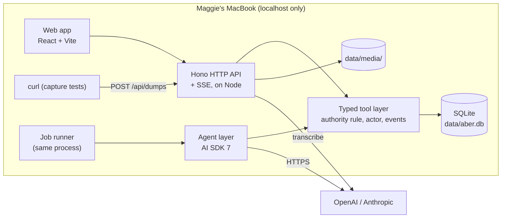

# Build spec: Aber v1

1 Nov 2026. For the overnight build agent. **This round builds Aber to run locally on Maggie's MacBook only.** Deployment (Coolify, Docker, Litestream, B2, auth, Tailscale) is out of scope; section 13 keeps the notes for later. Written in British English; confidence is stated where something is a judgement rather than a decision.

## How to use this document

| Read | For | Precedence |
| --- | --- | --- |
| [design-model.md](design-model.md) | Concepts, the authority rule, verbs, relationships, surfaces, behaviour, encoding map | **Wins on meaning.** If this spec and the model disagree about what something *is*, the model is right |
| This spec | Architecture, schema, tools, agent interface, slices, tests | Wins on how to build |
| The jigs (`jig/`), especially [`/app`](http://localhost:5181/app) and [`/reference`](http://localhost:5181/reference) | How things look and move | **Wins on visuals and motion.** Routes marked *canonical* are followed pixel for pixel |
| [design/decisions.json](../design/decisions.json) | Every pick, with Maggie's notes | Record only; already folded into the model and this spec |
| [agent-architecture-research.md](agent-architecture-research.md) | Why the agent stack is AI SDK 7 + an own SQLite queue, model prices, the per-job model plan | Decided 1 Nov 2026; section 5 here is the build version |
| [reference/interface-grammar.md](reference/interface-grammar.md) | Maggie's design method | Use the review gate before calling a slice done |
| [hosting-guide.md](hosting-guide.md) | Coolify deployment, Tailscale, secrets, Litestream, B2 and Shortcut steps | **Not used this round.** Deployment is in section 13 and the guide (rewritten for Coolify on 2 Nov) |

Run the jigs: `cd jig && bun install && bun run dev`, then open http://localhost:5181. `/reference` lists every canonical route and the constants that drive them.

## 1. Purpose and scope

Aber is Maggie's tool for developing theories of the near future. She dumps raw material; agents split it into **signals** and file them into **themes**; she states **theories** that could be wrong, watches what would change her mind, and spins up **prototypes**. v1 is the core loop:

| Step | In v1 |
| --- | --- |
| Capture | The dump-or-ask pill and column in the web app (text, links, images, voice), and the capture endpoint (tested locally with `curl`; the Apple Shortcut is later and optional) |
| Process | Transcription; the processing agent splits dumps into signals, files them, de-duplicates (exact links, tombstones, near-duplicate merges), drafts theories and prototypes, proposes revisions, replies |
| Browse | Five views (Theme sections, Columns, Atlas, Timeline, Briefing) and one shared object pane |
| Theories | Write, edit (versioned), confidence with an append-only stance log and sparkline, the tripwire sentence, evidence, rivals, follows-from, prototypes, retire with a reason |
| Briefing | An inbox lens over what changed since Maggie last looked |
| Agents | Process dumps, link evidence, tripwire, and chat replies in dump or ask |
| Narrow screens | Briefing and the object pane are responsive at phone width (tested in Playwright). Using it from the phone needs hosting, so that is later |

## 2. Non-goals for v1

| Not in v1 | Why, or when |
| --- | --- |
| Cluster, red-team, extrapolate, diagnosticity, de-duplicate beyond exact links and near-duplicate signals | Later agent jobs. Leave the job kinds in the enum; don't implement them |
| Deck, Document and River views | Deferred |
| Pin verb | Dropped |
| Multiplayer, accounts, sharing | Later (up to about 10 people). Keep `owner_id` on every row so it's cheap |
| Postgres | SQLite for v1, with the guardrails in 4.4 |
| The full app on a phone | Only Briefing and the pane are responsive in v1 |
| Deployment, remote access, auth, off-site backups | Later (section 13). This round runs on `localhost` only |
| Phone capture via the Apple Shortcut | Later and optional: the phone can only reach the laptop if both are on the same network or tailnet |
| Automatic inflows (feeds, scraping) | Inflows are manual only |
| Splitting themes | Merge and re-file instead |
| Dark mode | Not designed. Use tokens so it can be added |

## 3. Assumptions

| # | Assumption | Confidence | If wrong |
| --- | --- | --- | --- |
| A1 | One person (Maggie) uses v1. A single `people` row | High | — |
| A2 | Everything runs on Maggie's MacBook: Node 22 LTS or later, `npm` scripts, a SQLite file and media in a local data directory, server bound to `127.0.0.1` | High (decided for this round) | — |
| A3 | Nothing is exposed beyond the laptop, so there is no auth this round | High | Add the token auth in section 13 before any exposure |
| A4 | OpenAI and Anthropic API keys are in a local `.env` (git-ignored), so every job can switch provider in config | High | Run with OpenAI only; the Claude alternatives stay configured but unused |
| A5 | `ffmpeg` is installed locally (Homebrew) for splitting long audio | Moderate | Skip splitting; long audio fails with a clear error in the dump log |
| A6 | The laptop is awake when agent jobs run. Jobs queued while it sleeps run when it wakes | High | — |
| A7 | The jigs keep using Bun; the app uses Node | High | — |

## 4. Architecture

### 4.1 Overview



Everything that changes data goes through the typed tool layer, whether the caller is Maggie (via the HTTP API) or an agent. Agents never see SQL.

### 4.2 Repo layout

```
app/
  package.json            npm workspaces: web, server, shared
  shared/                 zod schemas, types, concept enums, tool names (imported by both sides)
  server/
    src/db/               schema.ts (Drizzle), migrations/, seed.ts (the jig world)
    src/tools/            one file per concept: dumps.ts, signals.ts, themes.ts, theories.ts, prototypes.ts, suggestions.ts, merges.ts
    src/tools/authority.ts
    src/agents/           models.ts (model per job), providers.ts, run.ts (agent_runs + cleanup), jobs/process-dump.ts,
                          link-evidence.ts, tripwire.ts, chat.ts, prompts/, fetch-article.ts
    src/jobs/             queue.ts, runner.ts
    src/http/             routes.ts, capture.ts, chat.ts, sse.ts, auth.ts, media.ts
    src/transcribe/
  web/
    src/ui/               lifted from jig/src/homes (atoms, panes, tripwire, confidence-spark, pill, views)
    src/data/             API client (hono/client), live store (replaces jig edits.ts)
    src/chat/             useChat wiring; tool-part → component map
    src/app/              shell, routes
  e2e/                    Playwright specs, one per slice
  evals/                  fixtures/ (~15 generated example dumps with expected outputs; Maggie's real dumps later) and *.eval.ts (Vitest)
scripts/backup.sh       optional: copies data/aber.db (via SQLite's backup API) and data/media/ to a dated folder
```

### 4.3 Stack

| Layer | Choice | Status |
| --- | --- | --- |
| Front end | React 19 + Vite + TypeScript, `motion`, `@phosphor-icons/react`, Inter | Decided (React); versions follow `jig/package.json` |
| Server | Hono on Node 22+ (`@hono/node-server`) | Decided |
| Database | SQLite via `better-sqlite3`, WAL mode, Drizzle ORM and migrations | SQLite decided; driver and Drizzle are judgements, moderate |
| Validation | zod, shared between server and web | Judgement, high |
| Client calls | `hono/client` typed RPC | Judgement, moderate |
| Live updates | Server-sent events | Judgement, high |
| Backups | Optional local copy (`npm run backup`); off-site backups are later | Decided for this round |
| Agents | Vercel AI SDK 7 (`ai`, `@ai-sdk/openai`, `@ai-sdk/anthropic`) in the Hono server; chat via AI SDK UI (`@ai-sdk/react` `useChat`). No Vercel hosting | Decided ([research](agent-architecture-research.md)) |
| Background jobs | A `jobs` table in Aber's SQLite with a worker loop in the server process | Decided |
| Tests | Vitest (unit and evals), Playwright | Decided (Vitest), judgement (Playwright, high) |

### 4.4 Database schema

Guardrails that keep a later move to Postgres cheap: text IDs (ULID); timestamps as ISO 8601 UTC text; booleans as `0/1`; JSON as text validated by zod; `STRICT` tables; no SQLite-only functions in application queries; every row has `owner_id`; all access through the tool layer.

Every mutable table carries `created_at, created_by, updated_at, updated_by`, where an **actor** is a string: `person:<id>` or `agent:<job>:<run_id>`. The run row holds the provider and model. They're shown once below as `-- audit` to keep the sketch short.

**`run_id` on every agent write.** Every table an agent can write to (signals, signal_sources, signal_origins, signal_themes, mentions, themes, theories, theory_themes, evidence, follows, prototypes, prototype_theories, suggestions, merges, replies, events) also carries a nullable `run_id TEXT REFERENCES agent_runs(id)`. That is what makes a retried job safe (4.10).

```sql
-- People and audit -----------------------------------------------------------
CREATE TABLE people (id TEXT PRIMARY KEY, name TEXT NOT NULL, created_at TEXT NOT NULL) STRICT;

-- Every write through the tool layer appends one event. History, undo and the dump log read from it.
CREATE TABLE events (
  id TEXT PRIMARY KEY, owner_id TEXT NOT NULL, at TEXT NOT NULL,
  actor TEXT NOT NULL,                       -- person:<id> | agent:<job>:<run_id>
  tool TEXT NOT NULL,                        -- e.g. 'fileSignal'
  object_kind TEXT NOT NULL, object_id TEXT NOT NULL,
  before_json TEXT, after_json TEXT,
  dump_id TEXT                               -- the dump that caused it, when there is one
) STRICT;
CREATE INDEX events_object ON events(object_kind, object_id);
CREATE INDEX events_dump ON events(dump_id);

-- Dumps, media, transcripts, replies ------------------------------------------
CREATE TABLE dumps (
  id TEXT PRIMARY KEY, owner_id TEXT NOT NULL,
  text TEXT NOT NULL DEFAULT '',             -- what was typed or shared, verbatim
  captured_at TEXT NOT NULL,
  captured_from TEXT NOT NULL CHECK (captured_from IN ('shortcut','web','column')),
  context_json TEXT,                          -- the "sees" pills when sent from the column: [{kind,id,label}]
  is_ask INTEGER NOT NULL DEFAULT 0,          -- text contained '?'
  status TEXT NOT NULL CHECK (status IN ('received','transcribing','processing','done','failed')),
  error TEXT,
  idempotency_key TEXT UNIQUE,
  deleted_at TEXT, purge_after TEXT           -- bin: purge_after = deleted_at + 30 days
  -- audit
) STRICT;

CREATE TABLE media (
  id TEXT PRIMARY KEY, owner_id TEXT NOT NULL,
  path TEXT NOT NULL,                         -- relative to data/media/
  mime TEXT NOT NULL, bytes INTEGER NOT NULL, sha256 TEXT NOT NULL, created_at TEXT NOT NULL
) STRICT;

CREATE TABLE dump_attachments (
  id TEXT PRIMARY KEY, dump_id TEXT NOT NULL REFERENCES dumps(id),
  kind TEXT NOT NULL CHECK (kind IN ('link','image','audio','file')),
  url TEXT, url_normalised TEXT, title TEXT, media_id TEXT REFERENCES media(id),
  position INTEGER NOT NULL
) STRICT;

CREATE TABLE transcripts (
  dump_id TEXT NOT NULL REFERENCES dumps(id), media_id TEXT NOT NULL REFERENCES media(id),
  text TEXT NOT NULL, provider TEXT NOT NULL, model TEXT NOT NULL, created_at TEXT NOT NULL,
  PRIMARY KEY (dump_id, media_id)
) STRICT;

-- The agent's answer to a dump: the AI SDK UI message parts (text and tool parts), so useChat can re-render them (6.9).
CREATE TABLE replies (
  id TEXT PRIMARY KEY, dump_id TEXT NOT NULL REFERENCES dumps(id),
  parts_json TEXT NOT NULL DEFAULT '[]',
  run_id TEXT NOT NULL REFERENCES agent_runs(id), created_at TEXT NOT NULL
) STRICT;

-- Signals ----------------------------------------------------------------------
CREATE TABLE signals (
  id TEXT PRIMARY KEY, owner_id TEXT NOT NULL,
  gist TEXT NOT NULL, note TEXT NOT NULL DEFAULT '',
  fetched_json TEXT,                          -- best effort; never required
  embedding BLOB,                             -- for similarity; float32 array
  seen_at TEXT,                               -- NULL = new since I last looked (blue dot)
  discarded_at TEXT,
  merged_into_id TEXT REFERENCES signals(id)  -- set on the absorbed signal while a merge stands
  -- audit
) STRICT;

CREATE TABLE signal_sources (
  id TEXT PRIMARY KEY, signal_id TEXT NOT NULL REFERENCES signals(id),
  url TEXT, url_normalised TEXT, author TEXT, published_at TEXT, title TEXT,
  own_observation INTEGER NOT NULL DEFAULT 0, position INTEGER NOT NULL
) STRICT;
CREATE INDEX signal_sources_url ON signal_sources(url_normalised);

CREATE TABLE signal_origins (            -- Came from: Signal ↔ Dump, many-to-many
  signal_id TEXT NOT NULL REFERENCES signals(id), dump_id TEXT NOT NULL REFERENCES dumps(id),
  created_at TEXT NOT NULL, created_by TEXT NOT NULL, PRIMARY KEY (signal_id, dump_id)
) STRICT;

CREATE TABLE tombstones (                -- discarded signals can't come back
  id TEXT PRIMARY KEY, owner_id TEXT NOT NULL, signal_id TEXT NOT NULL,
  gist TEXT NOT NULL, url_normalised TEXT, embedding BLOB, created_at TEXT NOT NULL
) STRICT;
CREATE INDEX tombstones_url ON tombstones(url_normalised);

CREATE TABLE mentions (
  id TEXT PRIMARY KEY, object_kind TEXT NOT NULL CHECK (object_kind IN ('signal','theme','theory')),
  object_id TEXT NOT NULL, dump_id TEXT NOT NULL REFERENCES dumps(id), at TEXT NOT NULL, created_by TEXT NOT NULL
) STRICT;

-- Themes -------------------------------------------------------------------------
CREATE TABLE themes (
  id TEXT PRIMARY KEY, owner_id TEXT NOT NULL, name TEXT NOT NULL,
  status TEXT NOT NULL CHECK (status IN ('draft','mine','retired')),
  retire_reason TEXT CHECK (retire_reason IN ('disproven','superseded','abandoned')),
  merged_into_id TEXT REFERENCES themes(id), seen_at TEXT
  -- audit
) STRICT;

CREATE TABLE signal_themes (             -- Gathered in
  signal_id TEXT NOT NULL REFERENCES signals(id), theme_id TEXT NOT NULL REFERENCES themes(id),
  created_at TEXT NOT NULL, created_by TEXT NOT NULL, PRIMARY KEY (signal_id, theme_id)
) STRICT;

-- Theories -------------------------------------------------------------------------
CREATE TABLE theories (
  id TEXT PRIMARY KEY, owner_id TEXT NOT NULL,
  claim TEXT NOT NULL, body TEXT NOT NULL DEFAULT '',
  status TEXT NOT NULL CHECK (status IN ('draft','held','retired')),
  retire_reason TEXT CHECK (retire_reason IN ('disproven','superseded','abandoned')),
  authorship TEXT NOT NULL CHECK (authorship IN ('agent','rephrased','mine')),
  horizon INTEGER,                         -- year
  tripwire TEXT NOT NULL DEFAULT '',       -- "I'd change my mind if …" (the words after "if")
  tripwire_version INTEGER NOT NULL DEFAULT 0,
  merged_into_id TEXT REFERENCES theories(id), seen_at TEXT
  -- audit
) STRICT;

CREATE TABLE theory_versions (           -- every edit to claim, body, tripwire or horizon
  id TEXT PRIMARY KEY, theory_id TEXT NOT NULL REFERENCES theories(id),
  claim TEXT NOT NULL, body TEXT NOT NULL, tripwire TEXT NOT NULL, horizon INTEGER,
  at TEXT NOT NULL, actor TEXT NOT NULL
) STRICT;

-- Confidence: append-only. Never UPDATE or DELETE (enforced by triggers).
CREATE TABLE stances (
  id TEXT PRIMARY KEY, owner_id TEXT NOT NULL, person_id TEXT NOT NULL REFERENCES people(id),
  theory_id TEXT NOT NULL REFERENCES theories(id),
  confidence INTEGER NOT NULL CHECK (confidence BETWEEN 1 AND 5),
  note TEXT NOT NULL DEFAULT '',
  cause TEXT NOT NULL CHECK (cause IN ('set','accepted_draft','challenge_accepted','undo')),
  suggestion_id TEXT REFERENCES suggestions(id),
  at TEXT NOT NULL
) STRICT;
CREATE TRIGGER stances_no_update BEFORE UPDATE ON stances BEGIN SELECT RAISE(ABORT, 'stances are append-only'); END;
CREATE TRIGGER stances_no_delete BEFORE DELETE ON stances BEGIN SELECT RAISE(ABORT, 'stances are append-only'); END;

CREATE TABLE theory_themes (             -- Positions on
  theory_id TEXT NOT NULL REFERENCES theories(id), theme_id TEXT NOT NULL REFERENCES themes(id),
  created_by TEXT NOT NULL, PRIMARY KEY (theory_id, theme_id)
) STRICT;

CREATE TABLE evidence (                  -- Signal → Theory, with a stance
  id TEXT PRIMARY KEY, signal_id TEXT NOT NULL REFERENCES signals(id), theory_id TEXT NOT NULL REFERENCES theories(id),
  stance TEXT NOT NULL CHECK (stance IN ('supports','undermines')), note TEXT NOT NULL DEFAULT '',
  UNIQUE (signal_id, theory_id)
  -- audit
) STRICT;

CREATE TABLE rivals (a_id TEXT NOT NULL, b_id TEXT NOT NULL, created_by TEXT NOT NULL,
  PRIMARY KEY (a_id, b_id), CHECK (a_id < b_id)) STRICT;          -- two-way, stored once
CREATE TABLE follows (theory_id TEXT NOT NULL, from_id TEXT NOT NULL, created_by TEXT NOT NULL,
  PRIMARY KEY (theory_id, from_id)) STRICT;                        -- theory follows from from_id

-- Prototypes -----------------------------------------------------------------------
CREATE TABLE prototypes (
  id TEXT PRIMARY KEY, owner_id TEXT NOT NULL, name TEXT NOT NULL, body TEXT NOT NULL DEFAULT '',
  draft INTEGER NOT NULL DEFAULT 0,
  status TEXT NOT NULL CHECK (status IN ('idea','building','built','shelved')),
  links_json TEXT NOT NULL DEFAULT '[]', seen_at TEXT
  -- audit
) STRICT;
CREATE TABLE prototype_theories (prototype_id TEXT NOT NULL, theory_id TEXT NOT NULL, created_by TEXT NOT NULL,
  PRIMARY KEY (prototype_id, theory_id)) STRICT;                   -- Embodies / Tests
CREATE TABLE prototype_media (prototype_id TEXT NOT NULL, media_id TEXT NOT NULL, position INTEGER NOT NULL,
  PRIMARY KEY (prototype_id, media_id)) STRICT;

-- Suggestions (proposals to my objects) ------------------------------------------------
CREATE TABLE suggestions (
  id TEXT PRIMARY KEY, owner_id TEXT NOT NULL,
  kind TEXT NOT NULL CHECK (kind IN ('evidence','revision','merge','challenge')),
  target_kind TEXT NOT NULL, target_id TEXT NOT NULL,
  payload_json TEXT NOT NULL,              -- evidence: {signal_id, stance, note}; revision: {claim?, body_insert?};
                                           -- merge: {other_id}; challenge: {signal_id, why, tripwire_version}
  reasoning TEXT NOT NULL,
  status TEXT NOT NULL CHECK (status IN ('pending','accepted','discarded')),
  run_id TEXT NOT NULL REFERENCES agent_runs(id), dump_id TEXT,
  decided_at TEXT, seen_at TEXT, created_at TEXT NOT NULL
) STRICT;
CREATE INDEX suggestions_target ON suggestions(target_kind, target_id, status);

-- Merges (near-duplicate signals; undoable) --------------------------------------------
CREATE TABLE merges (
  id TEXT PRIMARY KEY, owner_id TEXT NOT NULL,
  object_kind TEXT NOT NULL CHECK (object_kind = 'signal'),     -- theme/theory merges go through suggestions
  survivor_id TEXT NOT NULL, absorbed_id TEXT NOT NULL,
  snapshot_json TEXT NOT NULL,             -- both signals with sources, origins, themes, evidence, notes, before the merge
  reasoning TEXT NOT NULL, actor TEXT NOT NULL, dump_id TEXT,
  created_at TEXT NOT NULL, undone_at TEXT, undone_by TEXT
) STRICT;

-- Jobs ------------------------------------------------------------------------------------
CREATE TABLE jobs (
  id TEXT PRIMARY KEY,
  kind TEXT NOT NULL CHECK (kind IN ('transcribe','process_dump','link_evidence','tripwire','purge_bin',
                                     'cluster','red_team','extrapolate','diagnosticity','dedupe')),  -- last five: later
  payload_json TEXT NOT NULL, status TEXT NOT NULL CHECK (status IN ('queued','running','done','failed')),
  attempts INTEGER NOT NULL DEFAULT 0, run_after TEXT NOT NULL, locked_at TEXT, error TEXT,
  dedupe_key TEXT UNIQUE,                  -- e.g. 'process_dump:<dump_id>'
  created_at TEXT NOT NULL
) STRICT;

-- One row per agent run (a job attempt, or one chat turn). This is the design model's "processing runs".
-- Not shown in the app UI; query it directly.
CREATE TABLE agent_runs (
  id TEXT PRIMARY KEY, job_id TEXT REFERENCES jobs(id),          -- NULL for chat turns
  job TEXT NOT NULL,                                              -- process_dump, link_evidence, tripwire, chat, transcribe
  attempt INTEGER NOT NULL DEFAULT 1,
  provider TEXT NOT NULL, model TEXT NOT NULL, prompt_version TEXT NOT NULL,
  input_tokens INTEGER, output_tokens INTEGER, cached_input_tokens INTEGER, cost_usd REAL,
  status TEXT NOT NULL CHECK (status IN ('running','done','failed','cleared')),
  error TEXT, trace_json TEXT,            -- steps, tool calls and results (from onStepFinish), for debugging and evals
  started_at TEXT NOT NULL, finished_at TEXT
) STRICT;
```

Derived, not stored:

| Value | Derived from |
| --- | --- |
| Current confidence | Latest stance for the theory |
| Evidence balance (+s −u) | `evidence` rows, accepted only |
| Pending count (dashed badge) | `suggestions` with `status='pending'` on the object |
| Tripwire state | `empty` if `tripwire=''`; `watching` if no challenge suggestions for the current `tripwire_version`; `tripped` if any are pending; `resolved` if all are decided |
| Theme "open" | No held theories position on it |
| Mention count | `mentions` rows |
| New (blue dot) | `seen_at IS NULL` |

### 4.5 The typed tool layer

One module per concept. Each tool is a function `(ctx, input) => output` with zod schemas for input and output, registered by name. The HTTP API and the agent runtime call the same functions.

```ts
type Actor =
  | { kind: "person"; personId: string }
  | { kind: "agent"; job: AgentJobKind; runId: string };
type ToolCtx = { actor: Actor; ownerId: string; dumpId?: string; tx: Db };
type Tool<I, O> = { name: string; input: z.ZodType<I>; output: z.ZodType<O>; who: "person" | "agent" | "both"; run: (ctx: ToolCtx, i: I) => Promise<O> };
```

Each call runs in one transaction, appends an `events` row with `before_json` and `after_json`, and publishes an SSE message. A tool marked `person` is never offered to an agent, **and** checks the actor itself.

**Defined once, used three ways.** Each tool's Zod input schema and `run` function live in `server/src/tools/`. The same definition is exported as a plain function (for HTTP routes and tests) and, for agent-allowed tools, wrapped as an AI SDK `tool({ description, inputSchema, execute })` whose `execute` calls `run` with `actor = { kind: 'agent', job, runId }`. Shared Zod types live in `shared/` so the web app uses them too.

**The authority rule, enforced in `tools/authority.ts`:**

```ts
// Throws AuthorityError. Called at the top of every write tool.
function assertMayWrite(actor: Actor, target: { kind: ObjectKind; id: string; status?: string; createdBy?: string }, tool: string): void
```

| Rule | Check |
| --- | --- |
| Agents edit only their own drafts | For themes, theories and prototypes: agent writes require `status='draft'` (or `draft=1`) and `created_by` starting `agent:` |
| Agents may organise signals directly | `createSignal`, `attachOrigin`, `fileSignal`, `recordMention`, `mergeNearDuplicateSignals` are agent-allowed |
| Agents propose to my objects | Evidence, revisions, merges and challenges on held theories and on `mine` themes go through `propose*` tools only |
| Agents never change confidence | `setConfidence` and `decideSuggestion` are `person`; an agent actor throws |
| Agents never delete | No delete or discard tool is `agent` |
| Agents never undo my decisions | `undoMerge` and `decideSuggestion` are `person` |

**Tools**

| Tool | Who | Does |
| --- | --- | --- |
| `captureDump` | person | Store a dump with attachments and media; enqueue `transcribe` or `process_dump`. Returns at once |
| `deleteDump` | person | Move to the bin: remove signals whose sole origin is this dump, detach it from the rest, record everything removed in the event. Returns the counts for the confirmation |
| `previewDeleteDump` | person | The counts only ("removes 4 signals and 2 evidence links") |
| `restoreDump` | person | Undo `deleteDump` from its event, within 30 days |
| `getDump`, `listDumps` | both | Read, with status and what each produced |
| `createSignal` | agent | New signal from a dump, with sources and origin. Refuses if a tombstone matches the normalised URL |
| `attachOrigin` | agent | Add a dump as another origin of an existing signal (repeat link); records a mention |
| `fileSignal`, `unfileSignal` | both / person | Gathered in |
| `mergeNearDuplicateSignals` | both | Merge absorbed into survivor: move sources, origins, themes and evidence; join notes; write a `merges` row with a full snapshot and reasoning |
| `undoMerge` | person | Restore both signals exactly from the snapshot; set `undone_at` |
| `editSignal` | person | Gist and note |
| `discardSignal` | person | Set `discarded_at`, write a tombstone |
| `markSeen` | person | Set `seen_at` on signals, suggestions or drafts |
| `recordMention` | agent | A theme, theory or signal mentioned again in a dump |
| `writeTheme`, `renameTheme`, `retireTheme` | person | |
| `createDraftTheme` | agent | Only when no existing theme fits (judgement, moderate: v1 has no cluster job, so the processing agent needs this) |
| `writeTheory`, `editTheory` | person | Edits append a `theory_versions` row |
| `createDraftTheory`, `editDraftTheory` | agent | Own drafts only |
| `acceptDraft`, `rephraseDraft`, `discardDraft` | person | Accept sets `status` to `mine`/`held` and authorship; rephrase also edits the wording; discard sets a discarded state (drafts are removed from views, kept in events) |
| `setConfidence` | person | Append a stance (cause `set`, or `accepted_draft` on first acceptance) |
| `setHorizon`, `setTripwire` | person | Setting the tripwire bumps `tripwire_version` and enqueues `tripwire` (look-back) |
| `retireTheory` | person | Reason: disproven, superseded or abandoned |
| `linkEvidence`, `unlinkEvidence` | person; agent on own drafts | |
| `linkRivals`, `linkFollows`, `linkTheoryTheme` | person; agent on own drafts | |
| `writePrototype`, `editPrototype`, `setPrototypeStatus`, `linkPrototypeTheory`, `attachPrototypeMedia` | person | |
| `createDraftPrototype` | agent | |
| `proposeEvidence`, `proposeRevision`, `proposeChallenge`, `proposeMerge` | agent | Create pending suggestions. `proposeMerge` is unused in v1 |
| `decideSuggestion` | person | Accept, rephrase-then-accept, or discard. Accepting a challenge appends a stance one step lower (minimum 1) with note `Lowered: <gist>` and cause `challenge_accepted`. Undoing that decision appends a stance restoring the previous level (cause `undo`); the log stays append-only |
| `reply` | agent | Store the reply to a dump as UI message parts |
| `showTheory`, `showEvidenceSplit`, `showSignalList`, `showThemeActivity` | agent (chat only) | Read-only display tools: return the data a generative UI component renders (6.9) |
| `search`, `similarSignals`, `similarTheories`, `listThemes`, `listTheories`, `getTheory`, `getSignal`, `listTripwires` | both | Reads for agents and Find (⌘K) |

### 4.6 HTTP API

| Route | Purpose |
| --- | --- |
| `POST /api/dumps` | Capture (4.7). Also used by the column |
| `GET /api/dumps?bin=0\|1` | Dump log |
| `POST /api/tools/:name` | Call any `person` tool with JSON input; validated by its zod schema; actor is the session's person |
| `GET /api/world` | One snapshot for the views: themes, theories (with current confidence, balance, pending, tripwire state), signals (paged), prototypes, relationships |
| `GET /api/objects/:kind/:id` | One object with everything the pane shows |
| `POST /api/chat` | Dump-or-ask chat: stores the message as a dump, then streams the reply with `streamText` as an AI SDK UI message stream |
| `GET /api/events/stream` | SSE: dump status changes, new and changed objects, new suggestions |
| `GET /media/:id` | Serve a media file |
| `GET /healthz` | Liveness (used by hosting later) |

### 4.7 Capture endpoint (Apple Shortcut)

`POST /api/dumps`

| | |
| --- | --- |
| Auth | None this round (localhost only). Section 13 adds a bearer token |
| Body, JSON | `{ text?: string, urls?: string[], note?: string, from?: "shortcut" \| "web" \| "column", context?: Sees[] }` |
| Body, multipart | Fields as above, plus `file` parts (audio such as `.m4a`, images) |
| Idempotency | Optional `Idempotency-Key` header; a repeat returns the original dump |
| Limits | 250 MB per request (judgement: covers about an hour of Voice Memos audio; moderate) |
| Response | `201 { id, status: "received" }` within 1 s. Never waits for processing |
| Failure | Non-2xx with a short JSON error |

Text and the `note` field are stored verbatim in `dumps.text`. URLs become link attachments, normalised (lower-case host, strip `www.`, map `twitter.com` to `x.com`, drop `utm_*`, `fbclid`, `si`, `s`, `t` on x.com, and trailing slashes).

**Testing capture locally:**

```
curl -X POST http://127.0.0.1:3000/api/dumps -H 'Content-Type: application/json' \
  -d '{"text":"Small models are eating routine work","urls":["https://x.com/someone/status/123"],"from":"shortcut"}'
curl -X POST http://127.0.0.1:3000/api/dumps -F from=shortcut -F file=@note.m4a
```

The Apple Shortcut (hosting guide, Step 8b) posts the same body. It only works when the phone can reach the laptop, which needs the server bound beyond localhost and some auth (section 13), so phone capture is later and optional.

### 4.8 Transcription

| | |
| --- | --- |
| Where | Server-side, as a `transcribe` job before `process_dump` |
| Model | OpenAI `gpt-transcribe`, through the `@ai-sdk/openai` provider object (Anthropic offers no speech-to-text; [research, section 5](agent-architecture-research.md#5-model-plan-per-job)). `gpt-4o-transcribe` and `-mini` are deprecated |
| Long audio | Check the provider's per-file limit; if over, split with `ffmpeg` (in the image) on silence into chunks and join the text |
| Original | The audio is always kept as media |
| Run | Writes an `agent_runs` row like any other job |

### 4.9 Media

| | |
| --- | --- |
| Where | `data/media/YYYY/MM/<ulid>.<ext>` on local disk, hashed (sha256) |
| Served | `GET /media/:id`, `Cache-Control: private, max-age=31536000, immutable` |
| Backup | Optional `npm run backup` copies the database (using SQLite's online backup, so it's consistent while running) and `data/media/` into `backups/<date>/`. Off-site backup is later |
| Images | Outline `1px rgba(0,0,0,0.1)` when shown |

### 4.10 Jobs

A `jobs` table in Aber's SQLite, worked by a loop in the server process (decided; [research, architecture A](agent-architecture-research.md#a-ai-sdk-7-everywhere--own-sqlite-queue-recommended)).

| | |
| --- | --- |
| Claim | `UPDATE jobs SET status='running', locked_at=now WHERE id = (SELECT id FROM jobs WHERE status='queued' AND run_after<=now ORDER BY created_at LIMIT 1) RETURNING *` |
| Concurrency | 2 workers (judgement) |
| Runs | Each attempt opens an `agent_runs` row (`attempt` = n) and passes its `runId` to every tool call |
| Retries | 3 attempts, backoff 30 s, 5 min, 30 min; then `failed`, shown in the dump log |
| Restart from the beginning | A crashed or failed attempt is retried from the start, never resumed. **Before the retry, the runner clears the failed run's writes**: delete the drafts, suggestions, mentions, filings, origins, evidence, replies and signals carrying its `run_id`; undo its merges from their snapshots; mark the run `cleared`. Writes by a person are never touched, and nothing outside that `run_id` is |
| Idempotent writes | Tools that create something accept the `runId` and are no-ops on a repeat with the same key within a run (e.g. `createSignal` keyed on run + normalised URL or gist hash) |
| Stale locks | At start-up, `running` jobs locked for more than 10 minutes are treated as crashed: clear their run, then re-queue |
| Chaining | `transcribe` → `process_dump` → one `link_evidence` and one `tripwire` per new signal |
| Scheduled | `purge_bin` daily: hard-delete dumps past `purge_after` (and their media) |
| Spend | A per-day cost cap from env, summed from `agent_runs.cost_usd`; when hit, jobs wait until tomorrow and the dump log shows it |
| Batch | Later overnight jobs use the provider's batch API (about 50% off); not needed in v1 |

The runner clearing a failed run's writes is not an agent deleting anything: it puts back the state from before that attempt.

### 4.11 Local setup

| | |
| --- | --- |
| Data directory | `app/data/` (git-ignored): `aber.db` (WAL mode) and `media/`. Overridable with `ABER_DATA_DIR` |
| Binding | The server listens on `127.0.0.1:3000` only. Vite on `127.0.0.1:5173` proxies `/api` and `/media` to it |
| Env | `.env` (git-ignored): `OPENAI_API_KEY`, `ANTHROPIC_API_KEY`, `AGENT_MODE` (`live` or `fake`), `DAILY_SPEND_CAP_USD`, `ABER_DATA_DIR`. Models per job are in `server/src/agents/models.ts`, not env |
| Production-like run | `npm run build && npm start` serves `web/dist` and the API from one Node process on 3000 |
| Auth | None. Every route is open to `127.0.0.1` only |
| Health | `GET /healthz` (kept for later hosting) |

## 5. The agent layer

**Decided 1 Nov 2026** ([agent-architecture-research.md](agent-architecture-research.md), recommendation A, chosen by Maggie):

| Decision | Detail |
| --- | --- |
| Library | Vercel AI SDK 7 (`ai`) inside the Hono server on Node. The open-source library only; no Vercel hosting |
| Providers | `@ai-sdk/openai` and `@ai-sdk/anthropic`, both wired. **Always pass provider objects** (`openai('gpt-6.1-terra')`, `anthropic('claude-sonnet-5-5')`), never plain model-name strings: a bare string routes through Vercel's AI Gateway by default |
| Jobs | Own `jobs` table and worker loop (4.10); `agent_runs` records every run |
| Durability | A crashed job restarts from the beginning; `runId` on every write plus clean-up before retry makes that safe |
| Chat | `streamText` with display tools, rendered by `useChat` (6.9) |
| Evals | Vitest fixture tests on ~15 generated example dumps; Maggie's real dumps later (5.5) |
| Article content | Fetch the full article text and send it to the model for processing and evidence linking. Store it on the signal as best effort (`fetched_json`); a signal never depends on it |

### 5.1 Model per job

One config file, `server/src/agents/models.ts`, maps each job to a provider object. OpenAI first; the Claude alternative per job is configured beside it so switching is a one-line change. Prices and volumes are in the [research, section 5](agent-architecture-research.md#5-model-plan-per-job).

| Job | Model (OpenAI) | Configured alternative | v1 |
| --- | --- | --- | --- |
| Transcribe | `gpt-transcribe` | (stays on OpenAI) | Yes |
| Process a dump | `gpt-6.1-terra` | `claude-sonnet-5-5` | Yes |
| Link evidence | `gpt-6-luna` | `claude-haiku-5-5` | Yes |
| Tripwire | `gpt-6-luna` | `claude-haiku-5-5` | Yes |
| De-duplicate (including the automatic near-duplicate merge decision) | `gpt-6-luna` | `claude-haiku-5-5` | Near-duplicate merge: yes, as a step called from processing. Nightly de-duplicate: later |
| Chat (dump or ask) | `gpt-6.1-terra` | `claude-sonnet-5-5` | Yes |
| Cluster, diagnosticity, extrapolate, red-team | `gpt-6.1-sol` (batch for overnight) | per research | Later |

Keep every request under 100k input tokens (Claude Haiku's price cliff; hosting guide). OpenAI's guide says GPT-6 tool calling should use the Responses API; check `@ai-sdk/openai` does this when wiring it up (research, "Unverified", moderate).

### 5.2 The internal interface (for testability)

The app doesn't call the AI SDK from everywhere. Jobs go through one small seam so tests can swap in a scripted model:

```ts
// server/src/agents/run.ts
type AgentJob = "transcribe" | "process_dump" | "link_evidence" | "tripwire" | "near_dup" | "chat";

type AgentSpec = {
  job: AgentJob; promptVersion: string;
  system: string;
  tools: (runId: string) => Record<string, Tool>;  // AI SDK tool() objects built from the typed tool layer
  maxSteps: number;                                 // stopWhen: stepCountIs(maxSteps)
  maxInputTokens: number;
};

// Opens an agent_runs row, calls generateText / streamText with models[job] and the tools,
// records each step from onStepFinish into trace_json, then tokens, cost and status.
function runAgent(spec: AgentSpec, input: { prompt: string | ModelMessage[] }, ctx: { jobId?: string; attempt: number; dumpId?: string }): Promise<RunResult>;
function streamAgent(spec: AgentSpec, input: { messages: UIMessage[] }, ctx: { dumpId: string }): Response;   // chat

// Which model a job uses. In tests (AGENT_MODE=fake) this returns an AI SDK MockLanguageModel scripted from fixtures.
function modelFor(job: AgentJob): LanguageModel;
```

| Rule | Why |
| --- | --- |
| Tools reach the database only through the typed tool layer, with `actor = { kind: 'agent', job, runId }` | The authority rule lives in the tools, not in prompts |
| Tool errors (including `AuthorityError`) return to the model as tool results and land in `trace_json` | The agent can recover; tests can see violations |
| Every run writes `agent_runs`: job, provider, model, prompt version, tokens, cost, status, timings | The model's "processing runs"; spend cap; debugging. Not shown in the app UI |
| `AGENT_MODE=fake` uses the AI SDK's mock language model with scripted tool calls per fixture | Deterministic unit and e2e tests, no API keys |

### 5.3 v1 agent jobs

| | Process a dump | Link evidence | Tripwire |
| --- | --- | --- | --- |
| Trigger | `process_dump` after capture (and after `transcribe`) | Each new signal | Each new signal; and `setTripwire` (look back over signals from the last 90 days; judgement, moderate) |
| Model | `gpt-6.1-terra`; the near-duplicate decision is a separate `near_dup` call on `gpt-6-luna` | `gpt-6-luna` | `gpt-6-luna` |
| Input | Dump text, transcripts, attachments with **full fetched article text**, context pills, `is_ask`; theme list; held and draft theory claims; for each link, exact matches by normalised URL and tombstones; top similar signals by embedding | The signal (gist, sources, note, full fetched text); top 8 theories by embedding similarity, with claim, body and current evidence | The signal; theories with non-empty tripwires, pre-filtered by embedding similarity to the tripwire text (top 10) |
| Reads | `getDump`, `similarSignals`, `listThemes`, `listTheories`, `getTheory` | `getSignal`, `similarTheories`, `getTheory` | `getSignal`, `listTripwires`, `getTheory` |
| Writes | `createSignal`, `attachOrigin`, `fileSignal`, `mergeNearDuplicateSignals` (after `near_dup` says yes), `recordMention`, `createDraftTheme`, `createDraftTheory`, `createDraftPrototype`, `linkEvidence` / `linkTheoryTheme` / `linkFollows` on its own drafts, `proposeRevision`, `reply` | `proposeEvidence` on held theories; `linkEvidence` on drafts | `proposeChallenge` |
| Output | Signals filed into themes; merges; drafts; revision suggestions; a reply (filed tokens and draft cards) | Evidence suggestions with stance and one-line reasoning | Challenge suggestions with a one-line "why" (shown under the hit) |
| Must not | Create a signal whose URL matches a tombstone; create a second signal for an already-saved link; edit a held theory | Change confidence; touch held theories except by proposing | Change confidence. Only a person accepting a challenge lowers it |
| Near-duplicate rule | Merge only when both describe the same event or finding (not merely the same topic). Keep both sources. Join notes if both have one (judgement, moderate) | — | — |

Embeddings come from an OpenAI embedding model through the same provider (the hosting guide costs `text-embedding-3-small`; confirm it's current when wiring up). Fetching uses a plain HTTP fetch plus readability extraction (judgement, moderate); paywalled or failed fetches leave `fetched_json` empty and the dump still processes.

**Chat** (`POST /api/chat`, model `gpt-6.1-terra`): the message is stored as a dump first, then `streamAgent` answers with read tools plus the four display tools (`showTheory`, `showEvidenceSplit`, `showSignalList`, `showThemeActivity`) and the open context pills in the prompt. A material message is also enqueued for `process_dump`, whose filed tokens and drafts join the same reply.

Prompts live in `server/src/agents/prompts/<job>.md` with a version string; bump it on every change.

### 5.4 What the build agent builds

| Piece | Notes |
| --- | --- |
| `models.ts` | Job → provider object, OpenAI and Claude entries both present |
| `providers.ts` | `createOpenAI` and `createAnthropic` with keys from env |
| `run.ts` | `runAgent`, `streamAgent`, `modelFor`, `agent_runs` writes, cost from token counts and a price table copied from the research doc |
| `cleanup.ts` | Clear a run's writes before a retry (4.10) |
| Tool wrappers | Agent-allowed tools as AI SDK `tool()` objects from the shared Zod schemas |
| Fake mode | Scripted mock models per fixture for tests |

### 5.5 Evals

Vitest fixture tests in `app/evals/`, run with `npm run eval` against live models (costs money; not part of CI). Unit and e2e tests use fake mode.

| Order | Eval | Checks |
| --- | --- | --- |
| 1, first | **OpenAI vs Claude on the seeded example dumps in `evals/fixtures/`**, before locking models | Same checks as below, run once per configured model per job; prints a side-by-side table of pass rates, tokens and cost. promptfoo is optional for a richer side-by-side |
| 2 | Dumps with expected outcomes in `evals/fixtures/` | Signal count within a range; each filed to an expected theme; repeat links attach instead of duplicating; tombstoned links never return; planted near-duplicates merge and decoys (same topic, different finding) don't |
| 3 | 10 theory + signal pairs | Evidence stance matches the label |
| 4 | 8 tripwires with planted hits and decoys | Hits trip; decoys don't |
| Every run | | Zero `AuthorityError`s in traces |

**Seed examples.** The build agent writes ~15 realistic example dumps as fixtures in `evals/fixtures/`, set in the jig world (`jig/src/homes/data.ts`: Cost of intelligence, Agent memory, Code review after agents, Personal software, AI funding cycle, Novel agent interfaces, Agent identity). The mix:

- X/Twitter links with short commentary
- Article links
- A long, rambling voice-note transcript (3–5 minutes' worth of text)
- A text dump with a speculative claim
- One that repeats an earlier link
- One near-duplicate observation from a different source
- One describing something to build
- One question-style chat message

Each fixture has hand-written expected outputs beside it: signals with gists, theme filings, drafts, evidence and revision suggestions, and de-dup behaviour (attach, merge, or keep apart). The first eval compares OpenAI (the configured default per job) with the Claude alternative on these fixtures.

Follow-up: Maggie's real dumps replace or extend the seeded examples later; the harness and expected-output format stay the same.

## 6. Interface spec by surface

Lift components from `jig/src/homes/` rather than rewriting them. Replace the jig's in-memory `edits.ts` store with a live store backed by the API and SSE, keeping its shape (`useEdit(kind, id)` → `[record, set]`) so lifted components change little. Seed the database with the jig world (`jig/src/homes/data.ts`, `trips.ts`, `histories.ts`) so the app and `/app` can be compared side by side.

**Canonical** means: match the jig pixel for pixel, including spacing, type, colour, shadow, timing and easing. Constants are listed on [`/reference`](http://localhost:5181/reference); the table in 6.12 gives the values found in the code on 1 Nov 2026 as a fallback. If `/reference` and the code disagree, the code in `jig/src/homes/` wins and the difference goes in `docs/build-notes.md`.

### 6.1 Shell

| | |
| --- | --- |
| Canonical | [`/app`](http://localhost:5181/app); `homes/app-shell.tsx`, `app-shell.css` |
| Layout | The view fills the frame; the object pane and the dump column dock on the right and push the view. The column owns the far-right edge; the pane sits left of it |
| View switcher | Floating bottom-left (`left 12, bottom 24`), float shadow, one icon per view, the current one filled on a sliding highlight (`layoutId`, spring 0.3 s, bounce 0.1). ⌘1–⌘5. Switching cross-fades over 0.22 s with scale 0.985 → 1 in and 1 → 1.01 out (none under reduced motion). Whatever is open stays open |
| Esc stack | One stack of transient surfaces, most recent last. Order: stop picking or discard a take; then close the most recent of pane and column; a folded-out signal folds before its pane closes; Timeline levels and Follow chain close before the pane |
| Open object | Clicking a theory, theme heading, territory, landmark or dot opens it in the pane. Opening another object swaps the pane's content with a 0.14 s fade and scrolls it to the top |
| URL | `?view=` and `?open=<kind>:<id>` reflect state so a reload and the back button restore it (judgement, high) |

### 6.2 Object pane

| | |
| --- | --- |
| Canonical | [`/app`](http://localhost:5181/app); `homes/panes.tsx`, `panes.css`; details on [`/details`](http://localhost:5181/details) |
| Enter / exit | Slides in from the right edge and leaves the same way: spring 0.5 s, bounce 0.08 (none while dragging or under reduced motion) |
| Snaps | compact 480, half (even split), wide (view default), full (view folds to its strip). `PANE_MIN` 400. Half merges into a neighbour within 40 px; **half wins over compact**. Remembered per view for the session. The view folds to its strip once the pane passes halfway from wide to full |
| View defaults | Wide keeps: Theme sections 232 + 296 px of view; Atlas 420; Columns its open column; Timeline pane 560. Full keeps a strip: Theme sections 232, Atlas 180, Timeline 200, Columns its rails |
| Drag | The left edge is a separator (`role="separator"`). On approach: hairline and grip (60 ms delay). Pointer follows 1:1; rubber-band past either end at 0.2; on release, aim = last width + velocity × 160 ms (no throw if held still for more than 80 ms); settle on the nearest snap |
| Keyboard | ⌘[ wider, ⌘] narrower; ⌥← / ⌥→ outside text; ← / → on the focused edge. Full-width and Close buttons top right with tooltips naming the shortcut |
| Theory document | Theme chips; claim (editable title; dashed when a draft); labelled rows **Confidence** (five steps, sparkline A, challenge mark) or, for a draft, Accept / Discard; **Happens by** (− year +); **Rival** chips; body (editable); the tripwire sentence; **Supports** and **Undermines** columns with counts and + to add, signal rows that unfold in place (suggested ones dashed); chips for follows-from (←), leads-to (→, dashed if draft) and prototypes |
| Theme document | Name (editable); **Signals** count, open mark if no theory; theory tiles plus a + tile; signal rows |
| Prototype document | Name; **Status** (idea, building, built, shelved: the chosen one shows its name, the others are glyphs named on focus); **Tests** (theory chips); media; notes; links |
| Labels | Field labels are persistent on the pane. Nothing on it is hover-only |
| Edits | Save on blur and after 600 ms idle (judgement, moderate); every save is a tool call; theory edits append a version |

### 6.3 Tripwire

| | |
| --- | --- |
| Canonical | [`/details`](http://localhost:5181/details) variant C, used in the pane; `homes/tripwire.tsx`, `tripwire.css` |
| Form | A sentence under the body: Signpost icon inline, then "I'd change my mind if …". Wrapped lines return to the body's left edge |
| Empty | Two dotted rules to write on, starting where "if " ends |
| Watching | Phrase, full stop, a slow breathing grey dot (2.8 s; still under reduced motion) |
| Tripped | Signpost red; phrase underlined wavy red; a dashed count badge after the full stop toggles the matched signals. Each hit: gist, why, source; **Accept** (lowers confidence one step, note `Lowered: <gist>`) and dismiss. Decided hits show "Accepted, lowered to n" or "Dismissed" with Undo |
| Resolved | A tick and "n accepted, n dismissed"; toggles the decided hits |
| Data | Hits are `challenge` suggestions; decisions are `decideSuggestion` |

### 6.4 Confidence sparkline

| | |
| --- | --- |
| Canonical | Variant **A** (hard steps) on [`/details`](http://localhost:5181/details); `homes/confidence-spark.tsx` |
| Size | 52 × 20, scaled to the full 1–5 range; x from the first stance to today |
| Colour | Rise green `#1f7a4d`; fall amber `#b7791f`; fall from an accepted challenge red; flat ink-3 |
| Log | Hover or focus shows every dated change, newest first, nudged left to stay inside its surface |

### 6.5 Theme sections

| | |
| --- | --- |
| Canonical | [`/app?view=current`](http://localhost:5181/app?view=current); `homes/current.tsx` |
| Index | Left rail 232 px: "Aber" and Find (⌘K); one link per theme with its theory count or "open"; Prototypes link with count at the bottom. In compact mode a click opens the theme in the pane |
| Sections | Theme name (opens the theme), signal count, + when open; theory cards. Hovering a card rings its instances in other sections. Drafts sit at the end of their section; more than three collapse into a dashed stack, oldest at the back |
| Scroll | The sections scroll, never the page |

### 6.6 Columns

| | |
| --- | --- |
| Canonical | [`/columns#rails`](http://localhost:5181/columns#rails), hosted in [`/app?view=columns`](http://localhost:5181/app?view=columns); `homes/columns2.tsx` |
| Columns | Dumps 250, Signals 290, Themes 230, Theories 300, Prototypes 220. Folded columns become 44 px rails with an icon and related count |
| Stocks and flows | Themes, theories and prototypes open into the pane; dumps and signals unfold in place (note, theories, themes, dump chip) |
| Lineage | Keep the existing list order and scroll position when selecting or highlighting. Related items stay at full opacity; dim the rest. Show small related-item indicators above/below the visible scroll area, and scroll only when the person chooses an indicator. Selection uses a quiet surface, without a strong black outline. This is Maggie's explicit 1 November correction and supersedes the older "pull relatives to the top" wording in the read-only design model. |
| Full pane | Every column folds to a rail; clicking a rail restores the previous snap |

### 6.7 Atlas

| | |
| --- | --- |
| Canonical | [`/atlas#signals`](http://localhost:5181/atlas#signals) and [`/atlas#treatment-circles`](http://localhost:5181/atlas#treatment-circles), hosted in [`/app?view=atlas`](http://localhost:5181/app?view=atlas); `homes/atlas2.tsx`, `atlas2-camera.ts`, `atlas-styles/*` |
| Structure | **Circles**, **Paper** treatment |
| Signals | **Halos revealed on zoom**: faint halos at rest; ticks (supports above-right, undermines below-left) clear past zoom 1.6; gists label ticks past 2.5. Blue new, dashed suggested, red challenge |
| Labels | Every landmark shows its claim past zoom 1.6; below 0.55 only the open territory's name stays |
| Camera | Zoom 0.5–4. Drag to pan with inertia (4 px slop; the click ending a drag never opens anything); two-finger scroll pans; pinch or ⌘-wheel zooms; + − 0 and arrows (96 px steps). Fly-to spring 0.6 s, bounce 0 |
| Open | A territory or landmark opens in the pane and the map centres on its territory |
| Layout | Territory and landmark positions need a layout function for real data (the jig uses fixed positions in `atlas-styles/geo.ts`). **Ambiguity:** no jig defines placement for arbitrary themes. Use a deterministic circle-packing of territories sized by signal count, landmarks placed by evidence within their territory; note it for Maggie (judgement, low) |

### 6.8 Timeline

| | |
| --- | --- |
| Canonical | Field 2 on [`/timeline#chain-morph`](http://localhost:5181/timeline#chain-morph), hosted in [`/app?view=timeline`](http://localhost:5181/app?view=timeline); `homes/timeline-app.tsx`, `timeline2-fieldx.tsx`, `timeline2-chainview.tsx`, `timeline2-graph.ts` |
| Axes | Year across, confidence down; drafts in their own dashed row. Black ink |
| At rest | Nothing connected. Labels sit on their own dots and truncate rather than move (full text on dwell) |
| Select | Opens in the pane. Direct causes and consequences only, each with a "+n" badge that opens one more level; levels stack; Esc closes the last |
| Follow chain | Morphs the field into columns by depth with claims in full; Esc morphs back |
| Drag | A theory drags to a new year (and confidence, for held theories), after a 5 px threshold. Each drop is `setHorizon` and, if confidence moved, `setConfidence` |
| Width | Below 760 px the field keeps its width and scrolls sideways; 72 px reserved at the bottom for the switcher and pill |

### 6.9 Dump or ask (pill and column)

| | |
| --- | --- |
| Canonical | [`/pill`](http://localhost:5181/pill) sections 1, 2, 2b and 3 (B2), hosted in [`/app`](http://localhost:5181/app); `homes/pill-study.tsx`, `pill-study.css` |
| Pill | Bottom-right. Dump icon, the name of what it sees (the open object first, else the view), mic inside the pill. Approach lifts it slightly; hovering the name outlines that region |
| Open | Click or ⌘J: a full-height column (372 px with margins) grows up out of the pill; spring 0.5 s, bounce 0.12; closes back into the corner, spring 0.38 s, bounce 0 |
| Context | The pills float above the input, lined up with its left edge; removable; the crosshair toggles picking, and clicking any `[data-pick]` object adds it. Esc stops picking |
| Composer | "Dump anything, or ask"; Return sends, Shift-Return a new line; a pasted URL becomes a link chip (favicon at once, title resolves after); + attaches; mic records; send is an up arrow that becomes a question mark (ask) when the text contains "?" |
| Voice | The mic turns the pill (or composer) into the take: discard, live waveform, time, stop. Stop sends the note as a dump. Recorded notes show a scrubbable waveform and the transcript |
| Sent | Every message is a Dump (`captured_from='column'`, `context_json` from the pills), stored before the model is called. Material in it is then processed by `process_dump` as usual. Attachments on a sent message stack (style `fanX`) |
| Reply | A spinner while working, then staggered blocks (0.07 s): text; **filed** tokens (theme icon, name, count badge; click lists the gists); **draft** cards (dashed; accept and discard on the card's top edge; accepting solidifies it in place). Drafts accepted here solidify wherever else they show |
| Generative UI | The column uses AI SDK UI `useChat` against `POST /api/chat`. Replies are text plus typed tool parts; the web app switches on `part.type` and renders, when the part reaches `output-available`: `tool-showTheory` → **theory card**; `tool-showEvidenceSplit` → **evidence split** (supports / undermines columns, as in the pane); `tool-showSignalList` → **signal list** (signal rows); `tool-showThemeActivity` → **theme activity** (a theme's new signals, theories and counts since a date). Processing results render as the jig's **filed** tokens and **draft** cards. Each component is the same one the views use. Unknown part types are dropped and logged. Parts are stored in `replies.parts_json` so the thread re-renders after reload |
| Drop | Dragging links, images or cards onto the closed pill swells it and dumps them directly, without opening |
| Toast | After the column closes (or a direct dump finishes): counts made ("3 signals, 1 draft") with Undo, just above the pill; 5 s, held while hovered. Undo moves that dump to the bin (judgement, moderate; the jig only hides the toast) |

### 6.10 Dump log

| | |
| --- | --- |
| Canonical | [`/app`](http://localhost:5181/app) (the log segment on the pill); `homes/dump-log.tsx`, `dump-log.css` |
| Tier | 3. Rises out of the pill's log segment (a history glyph at the pill's left end, with a dot while a dump is processing or failed) and sinks back into it |
| Open / close | The log segment or ⌘⇧L. Esc, a second click or a click away closes it. Opening the dump column closes the log; the log never sits over the open column |
| Rows | Dump-kind icon, first line, time; status: processing, done (what it produced as object glyphs with counts, drafts dashed) or failed (the error, and Retry). Questions appear too, because every chat message is a dump |
| Delete | The trash icon on a row moves the dump to the bin for 30 days. **Meaning gap:** the design model says the consequences are shown before deleting ("removes 4 signals and 2 evidence links"); the jig deletes at once. Build the tier 5 confirmation with the counts from `previewDeleteDump`, and note it for Maggie |
| Bin | A Bin button with its count switches to deleted dumps, each with Restore; a back arrow returns |
| Merges | Undo for a near-duplicate merge lives in Briefing ("Merged") and on the surviving signal; also show it on the dump row that caused it (judgement, moderate) |

### 6.11 Briefing

| | |
| --- | --- |
| Canonical | [`/app?view=briefing`](http://localhost:5181/app?view=briefing); `homes/briefing-app.tsx`, `briefing-app.css` |
| Content | Everything with `seen_at IS NULL`, in one calm column grouped by kind: **Challenges** (tripwire hits: accept lowers confidence one step, or dismiss; shares the pane's decision), **Drafts** (theories, themes, prototypes; dashed until accepted), **Suggestions** (evidence, revised claims, theme merges), **Merged** (near-duplicate signals merged automatically, one click to unmerge), **New signals** (by theme, folded to a count) |
| Keys | While Briefing has focus and you aren't typing: J / K move, A accepts (or marks seen), X discards, U unmerges, Return or O opens the object in the pane. Settled items slide out to the right |
| v1 sources | Theme-merge suggestions and clustered draft themes come from later jobs; render them if present, but nothing in v1 produces them except `createDraftTheme` in processing |
| Phone | Responsive single column; the pane opens full screen |

### 6.12 Constants found in the jig code (fallback for `/reference`)

| Constant | Value | Where |
| --- | --- | --- |
| Frame in `/app` | 1360 × 820 | `app-shell.tsx` (the jig frame; the app fills the window) |
| Pane snaps | compact 480, min 400, merge 40, Timeline wide 560 | `app-shell.tsx` |
| Pane dock spring | 0.5 s, bounce 0.08 | `app-shell.tsx` |
| Throw projection | velocity × 160 ms; held > 80 ms = no throw; rubber band 0.2 | `app-shell.tsx` |
| View switch | 0.22 s, ease `[0.16, 1, 0.3, 1]`, scale 0.985 / 1.01 | `app-shell.tsx` |
| Dump column width | 372 | `pill-study.tsx` `DOCK_W` |
| Column open / close | spring 0.5 s bounce 0.12 / spring 0.38 s bounce 0 | `pill-study.tsx` |
| Toast | 5 s, re-checks every 1.5 s while held | `pill-study.tsx` |
| Atlas | zoom 0.5–4; claims at 1.6; far 0.55; ticks reveal 1.6; gists 2.5; pan step 96; slop 4 | `atlas2.tsx`, `atlas2-camera.ts`, `atlas-styles/signals.ts` |
| Timeline | min width 760; bottom reserve 72; drag threshold 5 px | `timeline-app.tsx`, `timeline2-fieldx.tsx` |
| Columns | widths 250 / 290 / 230 / 300 / 220; rail 44 | `columns2.tsx` |
| Sparkline | 52 × 20 | `confidence-spark.tsx` |
| Standard ease | `cubic-bezier(0.16, 1, 0.3, 1)` | `homes.css` `--ap-ease` |

## 7. Slices, in build order

Each slice is a vertical cut that works end to end, ends with its Playwright spec passing, and is one commit (or a short series) on its own branch. Use `AGENT_MODE=fake` and the seeded jig world for all e2e checks.

### Slice 0: Scaffold

| Acceptance criterion | Check |
| --- | --- |
| `npm install && npm run dev` starts the server (Node) on 3000 and Vite on 5173 with a proxy | `e2e/00-scaffold.spec.ts`: `/healthz` returns 200; `/` renders the empty shell |
| Migrations create every table in 4.4; `npm run seed` loads the jig world | Unit: row counts match `data.ts` |
| The tool registry exists with `assertMayWrite`; an agent actor calling a `person` tool throws `AuthorityError` | Unit: `tools/authority.test.ts` |
| Every tool call writes one `events` row with the actor | Unit |
| `stances` rejects UPDATE and DELETE | Unit |
| Tokens (`--ap-*`), Inter, atoms and `OBJECT_ICONS` are lifted; Theme icon is Binoculars | Unit snapshot of `OBJECT_ICONS` names |
| The server refuses connections on any interface but `127.0.0.1` | e2e: binding check |

### Slice 1: Capture, dump stored, dump log

| Acceptance criterion | Check |
| --- | --- |
| `POST /api/dumps` with JSON text and URLs returns 201 in under 1 s and stores the dump verbatim with normalised link attachments | `e2e/01-capture.spec.ts` via `request` |
| Multipart with an `.m4a` stores media on disk, hashed, and enqueues `transcribe` | e2e + unit |
| A repeated `Idempotency-Key` returns the same dump | e2e |
| The pill sits bottom-right; ⌘J opens the column; sending text creates a dump with `captured_from='column'` and its context | e2e |
| The dump log rises from the pill's log segment (or ⌘⇧L), lists dumps newest first with status; Esc and click-away close it | e2e |
| Delete shows the confirmation with counts; the dump moves to the bin; Restore brings back everything it removed | e2e + unit on `deleteDump` / `restoreDump` |
| `purge_bin` hard-deletes dumps past 30 days | Unit with a fake clock |

### Slice 2: Agent layer setup

| Acceptance criterion | Check |
| --- | --- |
| `models.ts` maps every v1 job to an OpenAI provider object, with the Claude alternative beside it; a lint test fails if any model is given as a plain string | Unit: `agents/models.test.ts` scans for `model: "` strings |
| `providers.ts` builds OpenAI and Anthropic providers from env; with `AGENT_MODE=fake`, `modelFor` returns scripted mock models | Unit |
| Agent-allowed tools are AI SDK `tool()` objects built from the same Zod schemas as the typed tool layer; `person` tools are absent from every agent tool set | Unit |
| The `jobs` table and worker loop claim jobs, retry with backoff (30 s, 5 min, 30 min) and mark `failed` after 3 attempts | Unit with a fake clock |
| Each attempt writes an `agent_runs` row with job, provider, model, prompt version, tokens, cost, status, timings and trace | Unit |
| **Retry clean-up:** a fake job that creates a draft theory, a suggestion and a signal and then throws is retried; before the retry, everything carrying the failed `run_id` is gone, its merges are undone, the run is `cleared`, and the second attempt's writes are the only ones left | Unit: `jobs/retry-cleanup.test.ts` |
| Clean-up never touches rows written by a person or by another run, even on the same objects (e.g. a note Maggie added to a signal the failed run created survives as an event and blocks deleting that signal; the run is marked `failed` instead, with a note) | Unit |
| A job whose lock is older than 10 minutes at start-up is treated as crashed: its run is cleared and it is re-queued | Unit |
| A repeat tool call with the same run and key is a no-op | Unit |
| The daily spend cap, summed from `agent_runs.cost_usd`, pauses the queue | Unit |
| One live smoke call per provider succeeds when keys are present (skipped otherwise) | `npm run smoke:providers` |

### Slice 3: Processing → signals filed into themes

| Acceptance criterion | Check |
| --- | --- |
| `transcribe` stores a transcript from `gpt-transcribe` (fake in tests), then enqueues `process_dump` | Unit |
| `process_dump` in fake mode turns fixture D1 into three signals filed in "Cost of intelligence", each with D1 as origin | `e2e/03-process.spec.ts`: capture → SSE → signals appear in the dump log row and in `/api/world` |
| A repeat link attaches the new dump to the existing signal and records a mention; no new signal | Unit + e2e |
| A link matching a tombstone creates nothing and is noted in the run trace | Unit |
| A near-duplicate merges: one signal, two sources, a `merges` row with snapshot; Undo restores both exactly | Unit (snapshot round-trip) + e2e (Undo in the dump log) |
| An agent attempt to edit a held theory fails with `AuthorityError` in the trace and changes nothing | Unit |
| Full article text is fetched and sent to the model; a failed fetch leaves `fetched_json` empty and the signal is still created | Unit with a stubbed fetch |
| `npm run eval -- --compare` runs the OpenAI vs Claude comparison over the eval fixtures and prints the table | Manual |

### Slice 4: Theme sections and the object pane (read and write)

| Acceptance criterion | Check |
| --- | --- |
| Theme sections matches `/app?view=current` with the same seed | `e2e/04-sections.spec.ts`: screenshot saved to `test-results/parity/` beside one of the jig (for Maggie; not a failing assertion) |
| Clicking a theory opens the pane from the right; Esc closes it the same way | e2e |
| Editing a claim, body, horizon or theme name persists across reload and appends a version for theories | e2e + unit |
| Pane snaps: ⌘[ and ⌘] step through compact / half / wide / full; with the column open, compact is skipped when it lands within 40 px of half | e2e reads the pane width |
| Dragging the edge and releasing settles on the nearest snap | e2e with `page.mouse` |
| Signal rows unfold in place showing note, theories, themes and dump | e2e |
| Prototype pane: status changes persist | e2e |
| The view switcher shows; ⌘1 is Theme sections | e2e |

### Slice 5: Theories, confidence, tripwire, evidence

| Acceptance criterion | Check |
| --- | --- |
| Setting confidence appends a stance and the sparkline gains a step in the right colour | `e2e/05-theories.spec.ts` + unit |
| The tripwire sentence moves empty → watching on blur with words | e2e |
| `link_evidence` (fake) proposes evidence; it shows dashed in Supports or Undermines; accepting makes it solid; discarding removes it | e2e |
| `tripwire` (fake) on a planted signal trips t3: signpost red, wavy underline, dashed count; Accept lowers confidence one step with note `Lowered: <gist>`; Undo appends a restoring stance | e2e + unit (stance log stays append-only) |
| Drafts: accept makes a draft held (no confidence until set), rephrase edits then accepts, discard removes it | e2e |
| Retire asks for disproven, superseded or abandoned | e2e |
| Rivals and follows-from chips open the linked theory | e2e |
| Agents can't call `setConfidence` | Unit |

### Slice 6: Briefing

| Acceptance criterion | Check |
| --- | --- |
| ⌘5 shows every unseen challenge, draft, revision, evidence suggestion and new-signal group | `e2e/06-briefing.spec.ts` |
| J / K move the cursor; A and X settle the item and it leaves; U unmerges a near-duplicate; Return opens the object in the pane | e2e |
| Acting marks items seen; their blue dots disappear in other views | e2e |
| At 390 px wide, Briefing is one column and the pane opens full screen | e2e with a phone viewport |

### Slice 7: Atlas

| Acceptance criterion | Check |
| --- | --- |
| ⌘3 shows circles on Paper with landmarks sized by confidence | `e2e/07-atlas.spec.ts` + parity screenshot |
| At rest halos are faint; past zoom 1.6 ticks clear and claims show; past 2.5 gists show | e2e via `+` key and DOM attributes |
| Clicking a territory opens the theme and centres the map; a drag never opens what it ends on | e2e |
| Layout is deterministic for the same data | Unit |

### Slice 8: Timeline

| Acceptance criterion | Check |
| --- | --- |
| ⌘4 shows the Field: year across, confidence down, drafts in a dashed row | `e2e/08-timeline.spec.ts` + parity screenshot |
| Selecting shows one hop with "+n" badges; a badge opens the next level; Esc closes levels one at a time, then the pane | e2e |
| Follow chain morphs to columns by depth; Esc morphs back | e2e |
| Dragging a held theory to another year and row persists horizon and appends a stance | e2e |
| With the pane at wide, the field scrolls sideways and keeps the selected theory in view | e2e |

### Slice 9: Columns

| Acceptance criterion | Check |
| --- | --- |
| ⌘2 shows the five columns in order | `e2e/09-columns.spec.ts` + parity screenshot |
| Opening a theory folds the other columns to rails with related counts | e2e |
| Unfolding a signal pulls its relatives to the top of each column and dims the rest | e2e |
| At full pane, every column is a rail; clicking one restores the previous snap | e2e |

### Slice 10: Dump-or-ask chat with generative UI

| Acceptance criterion | Check |
| --- | --- |
| Context pills float above the input, naming the open object then the view; removing one drops it from the sent dump's context | `e2e/10-chat.spec.ts` |
| The crosshair picks a theory card on screen into a pill; Esc stops picking | e2e |
| A message with "?" shows the question-mark send; it's stored as a dump with `is_ask=1` before the model is called; the reply streams through `useChat` | e2e |
| Asking about the open theory renders a **theory card** and an **evidence split**; asking what's new in a theme renders **theme activity**; asking for signals renders a **signal list**. Each is the same component the views use | e2e with scripted fake tool calls |
| After a reload, the thread re-renders from `replies.parts_json` | e2e |
| A material message gets a reply with `filed` tokens (count badges that unfold gists) and a `draft` card; accepting it solidifies it here and in Theme sections | e2e |
| Pasting a URL makes a link chip; attachments stack on the sent message | e2e |
| The mic records (fake media in tests), stop sends a voice dump; the transcript appears under the note | e2e with a fake `MediaRecorder` |
| Dropping a link on the closed pill dumps it without opening; the toast shows counts and Undo | e2e |
| Unknown tool-part types are dropped and logged | Unit |

### Slice 11: Capture from outside the app, and narrow screens

| Acceptance criterion | Check |
| --- | --- |
| `app/README.md` shows the `curl` captures (text, links, an audio file) and they produce dumps that process like any other | `e2e/11-capture.spec.ts` runs the same requests |
| `app/README.md` notes the Apple Shortcut as later and optional, linking hosting guide 8b | Review |
| At 390 × 844, `/` opens Briefing; theories open full-screen in the pane; no other view is reachable | `e2e/11-narrow.spec.ts` |
| Tap targets are at least 40 × 40 px | e2e measures them |
| `npm run backup` writes a consistent copy of the database and media to `backups/<date>/`; the copy opens and holds the latest dump | `scripts/backup.test.ts` |

## 8. Testing strategy

| Layer | Tool | Covers |
| --- | --- | --- |
| Tool layer | Vitest against a temp SQLite file | Every rule in the authority table, as agent and person actors; delete and restore round-trips; merge snapshot and undo; append-only stances; tombstones; event rows |
| Jobs | Vitest with a fake clock | Claiming, retries, backoff, run clean-up before retry, stale locks, chaining, spend cap |
| Agents | Vitest in fake mode (AI SDK mock models) | Each job's tool sequence on fixtures; `AuthorityError` reaches the trace; `agent_runs` rows; no plain-string models |
| Front end | Playwright (Chromium; WebKit for the phone slice) | The slice specs above, using keyboard paths as well as pointer paths, and `prefers-reduced-motion` once per view |
| Visual parity | Playwright screenshots of app and jig with the same seed | Saved for Maggie's review; not a failing check |
| Evals | `npm run eval` (Vitest) with live models | 5.5; run by hand; the OpenAI vs Claude comparison first |
| Accessibility | `@axe-core/playwright` on each view | No serious violations; every icon button has an accessible name |

## 9. Running locally

```
cd app
npm install                             # Node 22+
npm run db:migrate && npm run seed      # the jig world
AGENT_MODE=fake npm run dev             # server :3000, web :5173
npm test                                # Vitest unit tests
npx playwright test                     # e2e (starts the dev servers)
npm run eval                            # live models; needs API keys; costs money
```

Keep the jigs running beside it (`cd jig && bun run dev`, port 5181) to compare.

## 10. Definition of done for v1

| # | Statement |
| --- | --- |
| 1 | Every slice's acceptance criteria pass, and `npm test` and `npx playwright test` are green |
| 2 | A link captured with `curl` or the pill appears as a filed signal within a minute, traceable to its dump |
| 3 | A voice note (recorded in the pill, or an `.m4a` posted with `curl`) is transcribed and processed |
| 4 | All five views and the pane work with real data, and match their canonical jigs on the seed |
| 5 | Confidence history is an append-only stance log, and no agent can change it (unit-tested) |
| 6 | A planted signal trips a tripwire, and Briefing shows it the next time Maggie looks |
| 7 | A near-duplicate merge can be undone from the dump log, restoring both signals exactly |
| 8 | A deleted dump can be restored from the bin within 30 days, and is purged after |
| 9 | The app runs locally with `npm run dev` and `npm start`, bound to `127.0.0.1`, with data in `app/data/` |
| 10 | The interface-grammar review gate has been run over the built app, with findings in `docs/build-notes.md` |

## 11. Rules for the build agent

| Rule | Detail |
| --- | --- |
| Follow canonical jigs pixel for pixel | Lift the components; don't restyle. Where a jig and this spec disagree on visuals, the jig wins; on meaning, the design model wins |
| Use design tokens | Colour, type, spacing, radius, shadow and z-index from tokens only. Add a token rather than a literal |
| Concept names exactly | Dump, Signal, Theme, Theory, Prototype, Suggestion; verbs as in the matrix (retire, discard, delete are different). No synonyms in code or UI |
| No instructional text | No hints, no placeholder paragraphs, no "click here". Empty states show the action. The only placeholders are the composer's "Dump anything, or ask" and field names on the pane |
| Icon-first | At most one text button per surface; every icon button has an accessible name and a tooltip with its shortcut |
| Persistent labels on expanded surfaces | Nothing on the pane is hover-only |
| Maggie's UI rules | No dot separators (·, •). No coloured left-hand margins, borders or bars. As few type sizes as possible; distinguish with colour and weight. Condensed and minimal |
| Polish rules | Concentric radii; shadows over borders; tabular numbers; `text-wrap: balance` on headings and `pretty` on body; `scale(0.96)` on press; never `transition: all`; `AnimatePresence initial={false}`; 40 × 40 px hit areas; no rings or shadows clipped by scroll containers; reduced motion keeps spatial logic |
| One meaning per visual variable | Follow the encoding map in the design model. Don't introduce a new colour, border style or shadow meaning |
| The authority rule lives in tools | Never rely on a prompt to stop an agent doing something; enforce it in the tool and test it |
| Every write records its actor | No direct SQL outside the tool layer and migrations |
| Commit per slice | Branch per slice; explicit paths in `git add`; message `Slice n: <what works now>`; trailer `Co-Authored-By: Claude Opus 5.5 <noreply@anthropic.com>`. Don't push or open PRs unless asked |
| Stop rather than invent | On an ambiguity this spec and the jigs don't settle, choose the smallest reversible option, mark it `// AMBIGUITY:` in code, and add a line to `docs/build-notes.md` (what, where, what you chose, what Maggie needs to decide). If it affects the grammar (a new noun, verb, tier or visual meaning), don't build it; note it and move on |
| Don't edit the design sources | `docs/design-model.md`, `design/`, `jig/` are read-only for the build |
| Keep requests under 100k tokens | Per the hosting guide; set `maxInputTokens` per job |
| Provider objects only | Never pass a model as a plain string to the AI SDK (it would route via Vercel's AI Gateway) |

## 12. Known gaps for Maggie

| Gap | Where it bites | What the spec does meanwhile |
| --- | --- | --- |
| Real dumps for evals | Slice 2 | ~15 generated example dumps with hand-written expected outputs (5.5); swap in Maggie's real dumps later |
| Deleting a dump: the jig has no confirmation; the model shows consequences first | Slice 1 | Build the confirmation with counts, flagged |
| Atlas layout for arbitrary data | Slice 7 | Deterministic circle packing, flagged |
| Building-status blue equals the "new" blue | Everywhere prototypes show | Built as the jig shows; flagged in the encoding map |
| Phone pane presentation | Slice 11 | Full screen from the right (judgement) |

## 13. Later: deployment

Out of scope this round. Kept here so nothing decided is lost. The target is the **team Coolify server** (design model, Implementation notes), which makes Aber a work tool. The personal-server route was discarded on 2 Nov; the step-by-step version of this section, including where secrets live and how the deployed database starts empty, is the [hosting guide](hosting-guide.md).

| Piece | Notes from the earlier plan |
| --- | --- |
| Containers | Multi-stage `Dockerfile` (build `web` with Vite; runtime `node:22-slim` or later with `ffmpeg`; one process on port 3000). `compose.yaml` with `app` (volume `./data:/app/data`, healthcheck `/healthz`), `litestream` and `media-backup` sidecars on the same volume |
| Coolify | Builds from the Git repo. Don't attach a public domain. Bind to `127.0.0.1` or the internal network: Docker's published ports bypass host firewalls (hosting guide, Step 3). Confirm with the server's owner that Compose with a persistent volume works, and how the server joins Tailscale |
| Work-tool implications | Data sits on work infrastructure under work policies; anyone with access to the host can read the volume. Nothing in Aber should be more private than work notes. Moving later is a database file and a media folder |
| Network | Reachable only over Tailscale, never the public internet (hosting guide, Steps 2 and 6) |
| Auth | Web: visit `/login#<ABER_LOGIN_TOKEN>` once per device; the page posts the fragment to `POST /api/session`, which sets an `HttpOnly; Secure; SameSite=Strict` cookie signed with `ABER_SESSION_SECRET`. Capture: `Authorization: Bearer $ABER_CAPTURE_TOKEN`. Required on every route but `/healthz`, even on the tailnet |
| Database backup | Litestream streams `data/aber.db` to a private Backblaze B2 bucket (hosting guide, Step 7), with a quarterly restore drill |
| Media backup | `data/media/` to B2 hourly; `restic` rather than `rclone sync`, because a sync mirrors deletions (judgement, moderate) |
| Phone | The Apple Shortcut posting to `/api/dumps` with the bearer token; Tailscale VPN On Demand for `*.ts.net` (hosting guide, Step 8). Then the responsive Briefing and pane become reachable on the phone |
| Checks to write then | `docker compose up --build` smoke test against a MinIO stand-in for B2; a restore drill script; review that nothing listens publicly |

