# Aber · Design exploration log

A record of what was explored on 30–31 October 2026, what Maggie decided, what was rejected and why, and what is still open.

- **Source of truth:** [design-model.md](design-model.md). Read this log for history; read the model for the current state.
- **Visuals:** [design/space-and-motion/index.html](../design/space-and-motion/index.html) (exported from the Claude Design canvas). Screenshots appear inline below.

## Timeline

| Step | What happened | Outcome |
| --- | --- | --- |
| 1 | Maggie brain-dumped the idea: a personal tool for weak signals, themes, theories of the future, second- and third-order effects, and prototypes, with background agents doing sense-making | First grammar draft. Seven concepts, including **Question**. Since deleted from the repo; it's in git history at commit `f229d75` |
| 2 | Review of the draft | Question merged into Theme. Explicit **rivals** link. Database rather than Markdown, with a custom interface (not Obsidian). A theory is a claim plus a prose body. Inflows are manual only. "Dump" kept as the name |
| 3 | Database trade-offs | Postgres considered, then **SQLite for v1** with migration guardrails (Maggie alone in v1; 2–5 agents; multiplayer later) |
| 4 | Hosting | [hosting-guide.md](hosting-guide.md): Tailscale plus a small DigitalOcean server in London, about $13–14 a month. The team's Coolify server is an alternative, pending a work-vs-personal decision |
| 5 | Grammar second pass | Agents split dumps and file signals into existing themes directly; everything else is a suggestion. Retire / Discard / Delete defined. Chat and "subject" dropped as concepts |
| 6 | Drafts and de-duplication | Agent-made drafts behave like full objects. This generalised into **the authority rule**: agents can do anything to their own drafts, but can only propose changes to yours. Signal ↔ Dump becomes many-to-many; deleting a dump removes only the signals that came solely from it |
| 7 | Layers 2–3 proposed in text | Maggie couldn't judge space and motion from text, so they were drawn on a Claude Design canvas |
| 8 | Canvas review (4 comments) | Prototypes moved off the World page; a scale design added; "State a theory" shrunk to an inline icon; the capture bar became a floating dump-or-ask pill |

## Grammar decisions

| Question | Options considered | Decision |
| --- | --- | --- |
| Is "Question" a concept? | Separate noun vs part of Theme | **Merged into Theme.** A theme with signals but no theories is an open question |
| How are rival theories grouped? | By shared Question vs explicit link | **Explicit `rivals` link** between theories |
| Theme vs Theory | One concept vs two | **Two.** "What I'm seeing" vs "what I think will happen". Maggie confirmed this matches how she thinks |
| Theme structure | Flat vs nested | **Flat for now.** Revisit if 100+ themes need groups |
| What can agents do? | Everything as suggestions; or organise directly | **Authority rule:** agents create and freely edit their own drafts, organise directly (split, file, attach repeats), and only *propose* changes to your objects |
| Draft theories | Pending suggestion vs full object | **Full object** that collects evidence before acceptance. Accepting or rephrasing makes it yours |
| Signal gist | Agent writes vs user writes | **Agent writes by default; you can edit** |
| Deleting dumps | Never vs allowed | **Allowed.** Only signals whose sole origin is that dump go with it. A 30-day bin is proposed |
| Repeated signals | Duplicates vs merge | Same link: attach to the existing signal. Same observation: suggest a merge *(proposed)*. Repetition is recorded as mentions |
| Prototypes | Link only vs full concept | **Full concept from v1**: prose, images, video, links |
| Chat | Separate concept, no transcript, or a dump | Chat happens in the dump-or-ask panel. *Proposed:* each message sent is a Dump, and agent replies attach to it |
| Storage | Markdown in git, Postgres, SQLite | **SQLite for v1** behind a typed tool layer; Postgres when sharing arrives |

## Space and motion explored

### World page (base plane)

| Option | Verdict |
| --- | --- |
| A · theme sections | Current for small scale. Revised after review: no prototypes strip; open themes get an inline + |
| A2 · World at scale | Proposed answer to "100+ themes and hundreds of theories": pinned themes, what moved since yesterday, then a dense table of all themes. Adds a **Pin** verb (new grammar, unconfirmed) |
| B · theory board with theme filter | Alternative, not chosen. Hides open themes and doesn't scale either |
| C · cone canvas, and strata as the whole base plane (first draft only) | Rejected early. Placing things by hand is busywork, it becomes a hairball, and it's poor on phone |

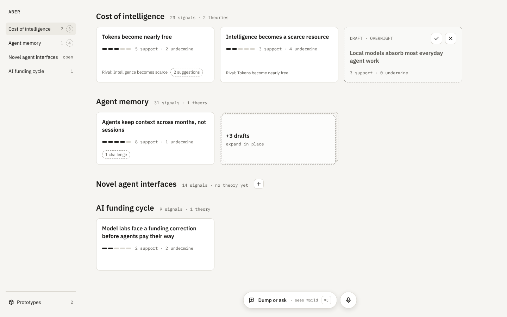

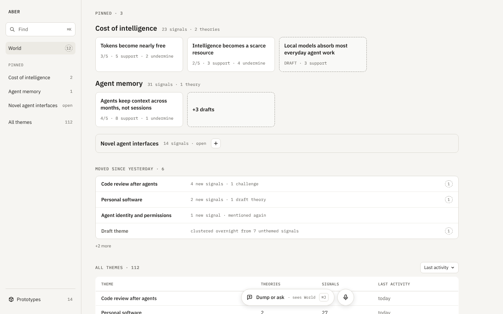

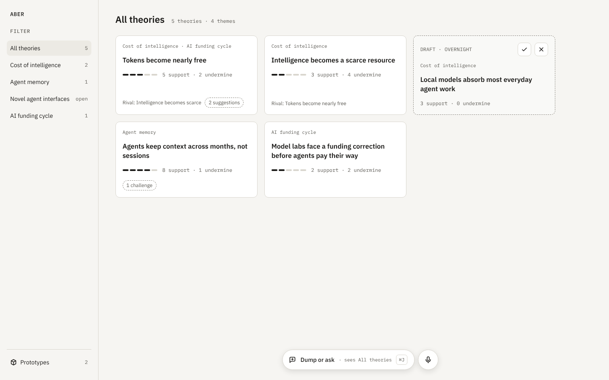

### Zoom levels and the theory compass

Going deeper always means zooming in, from World to Theme to Theory, and each level grows from the thing you clicked.

- **Theme level:** the theme's theories above, its signals below.
- **Theory level (the compass):**
  - prototypes above, evidence below;
  - causes left, consequences right;
  - rivals peek from behind.
- **Writing mode:** focusing a theory's body shrinks the compass directions to edge tabs.

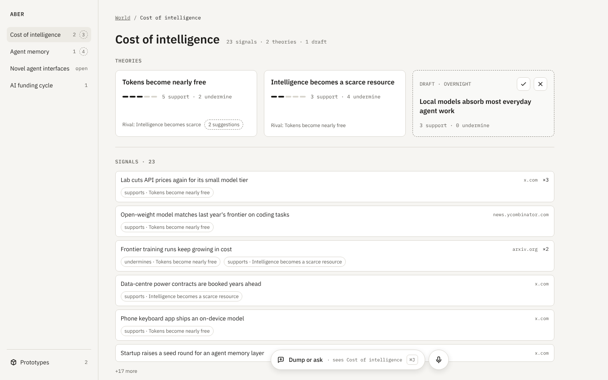

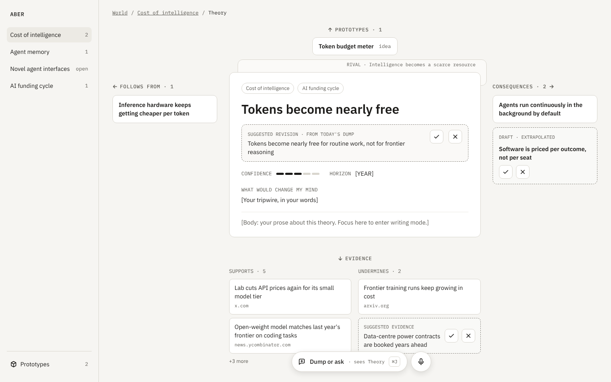

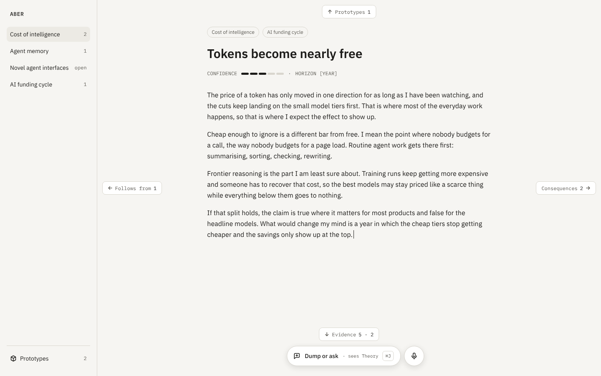

### Capture and chat

| Iteration | Verdict |
| --- | --- |
| Full-width capture bar docked at the bottom | **Rejected:** too big. Maggie wants something small that grows when needed |
| No chat transcript (dumping into a theory, with replies arriving as ghosts) | **Superseded:** Maggie wants to chat about anything on screen |
| Conversation panel docked beside a theory | **Superseded** by the pill. Its board was repurposed |
| **Floating "Dump or ask" pill**, bottom centre, plus a round mic button; grows into a panel with a SEES context row, the conversation and one input | **Current** |

On a pill the context shows as "sees World / Theory / …". In the open panel, the SEES row lists the context as removable chips, with a + to add more from the screen.

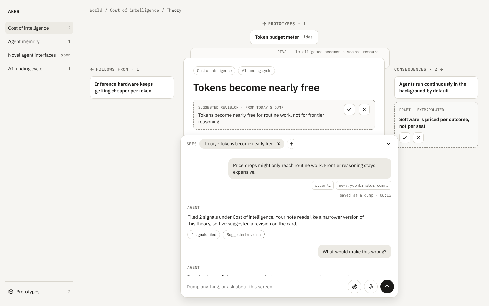

### Prototypes

The prototypes strip at the top of the World page was **rejected** as too central. Prototypes now have their own area, reached from a link pinned to the bottom of the rail. They are also linked from theories, sitting above the claim in the compass.

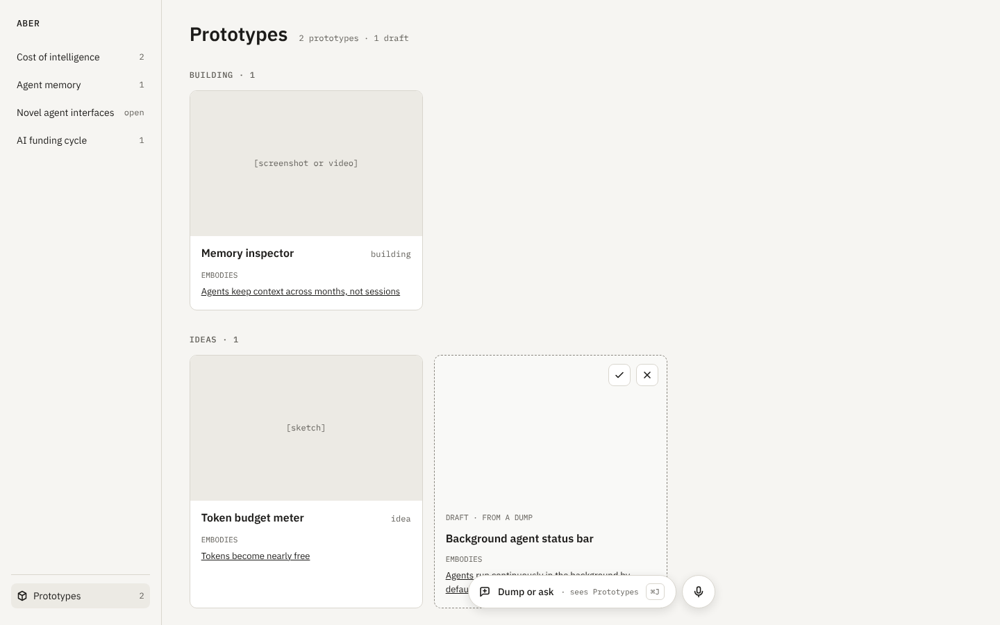

### Elevation, material and motion

- **Elevation encodes transience.** The scale runs from tier 0 to tier 7:
  - Tier 0 is the base plane.
  - Tier 1 is the docked theme index and the floating pill.
  - The dump-or-ask panel is tier 3 and grows from the pill.
  - The tooltip is tier 7.
- **"Not yet yours" is a material, not a tier.** Drafts and suggestions sit on the base plane with a dashed border, translucent fill and no shadow. A dashed border means only that.
- **Motion is a storyboard, not an animation.** It shows how a card grows into the compass and shrinks back.

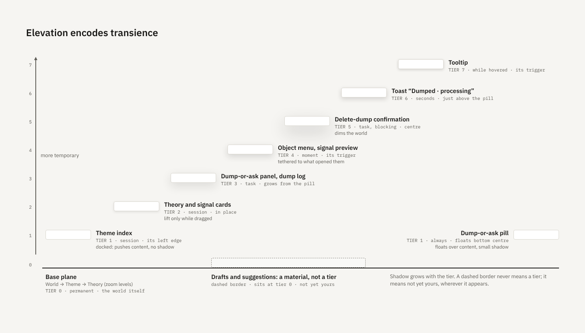

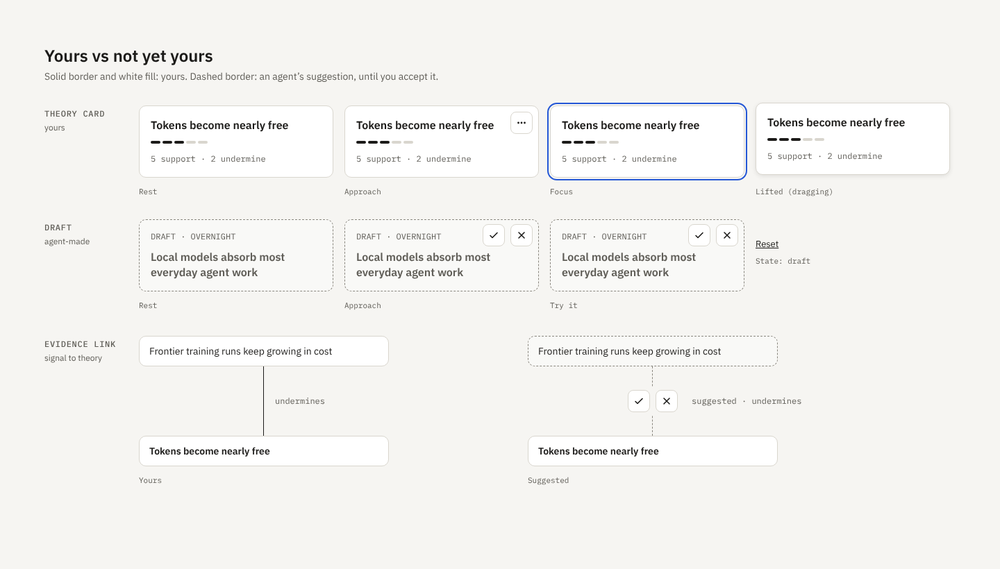

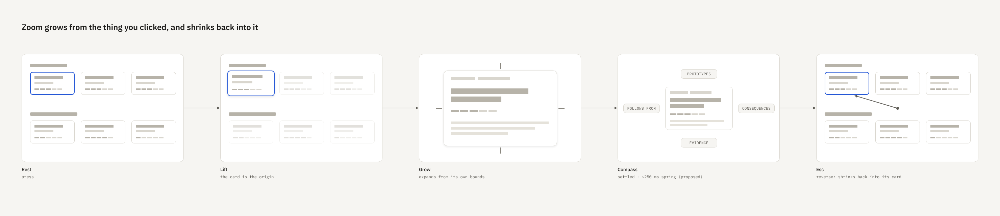

### Phone

On the phone, capture and triage come first. The pill and mic sit bottom centre. The compass becomes one vertical page whose sections keep their direction arrows. Morning triage steps through ghosts with swipes.

| | |
| --- | --- |
| 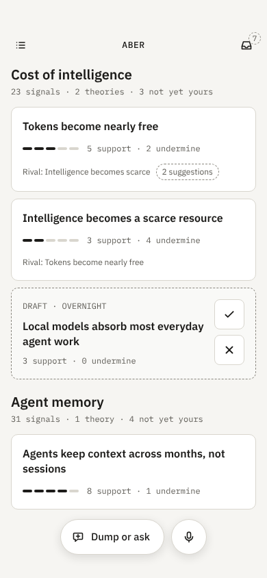 | 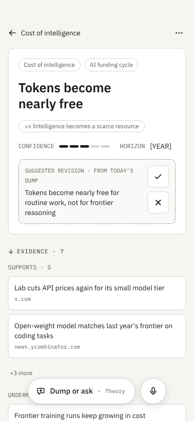 |
| 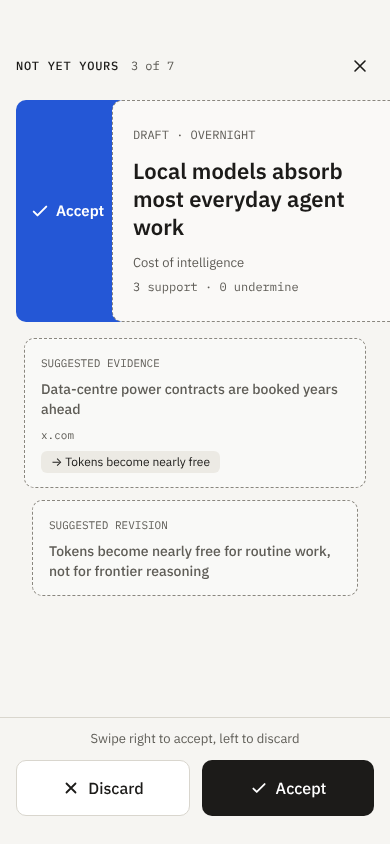 | 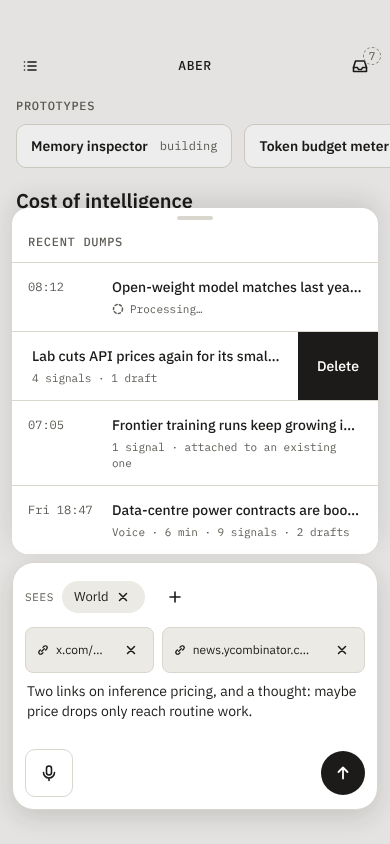 |

## Canvas feedback log

| Maggie's comment | Change made |
| --- | --- |
| Prototypes don't need to be this central; separate area or global nav, not the top of the main page | Removed the strip from the World page (laptop and phone). Added a Prototypes area linked from the bottom of the rail and the phone menu |
| How does this scale to 100+ themes and hundreds of theories? | Added board A2 (pinned / moved since yesterday / all-themes table, plus Find). Flagged the new Pin verb and the flat-themes risk |
| "State a theory" is too bold and big | Replaced it with a small inline + icon button |
| Capture shouldn't be full width; make it a small floating pill that morphs into a panel for dumping and chatting, with on-screen context fed to the agent | Pill and mic bottom centre on every screen. Panel board added. Elevation board and design model updated |

## Rejected or superseded, in one place

| Idea | Why it went |
| --- | --- |
| Question as a concept | Duplicated Theme |
| Markdown in git, or Obsidian as the interface | Maggie wants a robust custom interface; relationships and agent permissions fit a database |
| Postgres for v1 | Operational cost with no v1 benefit; migration stays cheap |
| "Bet" as a theory state | Starting a prototype is the bet |
| "Subject" relationship on dumps | Evidence links do the job; capture context is only a hint |
| Full-width capture bar; no-transcript chat; docked conversation panel | Replaced by the floating dump-or-ask pill |
| Prototypes strip on the World page | Too central |
| Option B as the base plane | Hides open themes; doesn't scale |

## Still open

See section 6 of [design-model.md](design-model.md). In short:

- the base plane at scale (A2) and the Pin verb;
- the compass directions;
- whether conversation messages are stored as dumps;
- where drafts live and whether they expire;
- hosting (own server vs team Coolify);
- the dump bin length;
- whether near-duplicate signals merge as a suggestion;
- several sources per signal;
- tombstones for discarded signals;
- retire reasons;
- media storage.
