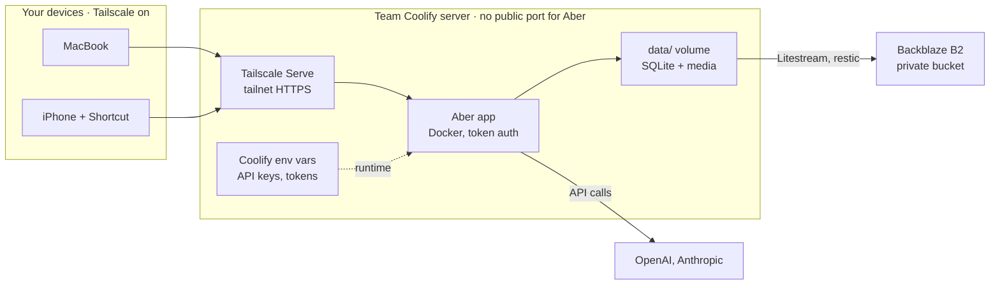

# Aber — Hosting Guide (team Coolify server)

2 Nov 2026 · @Maggie Appleton. Replaces the 31 Oct personal-server guide (DigitalOcean), which was discarded.

## Summary

Aber runs on the **team Coolify server** as a Docker Compose app. It's reachable **only** from your MacBook and iPhone, through Tailscale, and every request needs your token. There's no public domain, no public port and no login page facing the internet.



Two locks, both required:

| Lock | Stops |
| --- | --- |
| **Network:** Tailscale only, no public domain, port bound to `127.0.0.1` | Everyone on the internet |
| **App:** token auth on every route but `/healthz` | Anyone else who can reach the server on the tailnet |

**What it can't stop** (high confidence): people with root on the server or admin rights in Coolify can read Aber's volume and its environment variables. That's the price of a shared work server. Treat Aber as a work tool: nothing in it should be more private than your work notes. See [Who can see what](#who-can-see-what).

## The steps

1. Questions for the server's owner
2. Tailscale on your devices
3. Make the app deployable (code work, done by your coding agent)
4. Keys and tokens
5. Create the app in Coolify
6. Private HTTPS address with Tailscale Serve
7. Backups
8. iPhone capture
9. Security checklist

## Step 1: Questions for the server's owner

Ask these before anything else. The answers change steps 2, 5 and 6.

| Question | Why it matters |
| --- | --- |
| Is the server on Tailscale, and whose tailnet: the company's or a team one? | Decides how your phone and MacBook reach it (Step 2) |
| If it's a shared tailnet, can the ACLs limit Aber's port to your devices? | Without that, everyone on the tailnet can reach the login page. Token auth still protects it, but fewer doors is better |
| Can I run `tailscale serve` on the host, or does a Tailscale sidecar container work better here? | Step 6 assumes host access |
| Does Coolify support a Docker Compose app with a persistent volume on this server? | Aber keeps its SQLite file and media on disk |
| Can the Coolify proxy be skipped for this app (no domain)? | The app must not get a public route |
| Who has root on the host, and who is an admin in Coolify? | They can read Aber's data and keys |
| Is there a policy on API keys: personal keys, or a work-provided OpenAI/Anthropic account? | Decides whose keys go in Step 4 |
| Are server backups taken, and is Coolify's `APP_KEY` backed up? | Coolify encrypts stored variables with it; losing it loses the variables |

## Step 2: Tailscale on your devices

How you join depends on the answer about tailnets in Step 1:

- **The server is on a tailnet you can join:** install Tailscale on the MacBook ([download](https://tailscale.com/download)) and the iPhone (App Store), and sign in to that tailnet.
- **The server is on the company tailnet, and you'd rather not put your phone on it:** the owner can [share the server machine](https://tailscale.com/kb/1084/sharing) into your personal tailnet. Moderate confidence this fits; confirm with the owner.

Then check that MagicDNS and HTTPS certificates are on in the tailnet's admin console (DNS page). Serve needs both. Turning HTTPS on [publishes machine names in public certificate logs](https://tailscale.com/kb/1153/enabling-https), so keep names neutral.

> **Work laptop check:** if the MacBook is company-managed, check it may run Tailscale alongside any corporate VPN.

## Step 3: Make the app deployable (code work)

None of this exists in the repo yet. Ask your coding agent to do it on a branch, then test locally with `docker compose up --build`.

| Change | Detail |
| --- | --- |
| Configurable host | `app/server/src/config.ts` hard-codes `127.0.0.1`. Inside a container that makes the app unreachable through the published port. Read `HOST` from the environment; default `127.0.0.1` for local use, `0.0.0.0` in the container |
| Token auth | Web: visit `/login#<token>` once per device. The page posts the fragment to `POST /api/session`, which sets an `HttpOnly; Secure; SameSite=Strict` cookie signed with `ABER_SESSION_SECRET`. Capture: `Authorization: Bearer $ABER_CAPTURE_TOKEN`. Required on every route but `/healthz` |
| Replace the local-only guard | `app/server/src/http/app.ts` rejects any `Host` that isn't `localhost` or `127.0.0.1`. Tailscale Serve is reported to forward the `*.ts.net` name as `Host` ([test write-up](https://dev.classmethod.jp/articles/use-tailscale-builtin-reverse-proxy/); moderate confidence), so the guard would block every request. Replace it with token auth plus an allowed-hosts list (`ABER_ALLOWED_HOSTS`). Don't simply delete it |
| `Dockerfile` | Multi-stage: build `web` with Vite; runtime `node:22-slim` or later with `ffmpeg`; one process on port 3000; runs as a non-root user |
| `.dockerignore` | Excludes `.env`, `app/data/`, `app/backups/`, `reports/`, `node_modules` so no key or data ends up in an image |
| `compose.yaml` | `app` service with volume `./data:/app/data`, healthcheck `GET /healthz`, port `"127.0.0.1:3000:3000"`. Sidecars `litestream` and `media-backup` share the volume (Step 7) |
| Fail closed | The server refuses to start if `ABER_SESSION_SECRET` or `ABER_CAPTURE_TOKEN` is missing or short when `HOST` isn't loopback |
| Checks | `docker compose up --build` smoke test against MinIO standing in for B2; a restore-drill script; a check that nothing listens publicly |

> **Why `127.0.0.1:` matters** (high confidence): Docker's published ports bypass host firewalls such as UFW. `"3000:3000"` would expose Aber on the server's public address. `"127.0.0.1:3000:3000"` keeps it inside the server, where Tailscale Serve picks it up.

## Step 4: Keys and tokens

### What there is

| Variable | Secret? | Where it comes from |
| --- | --- | --- |
| `OPENAI_API_KEY` | Yes | OpenAI console: a key made only for Aber |
| `ANTHROPIC_API_KEY` | Yes | Anthropic console: a key made only for Aber |
| `TYPESAFE_API_KEY` | Yes | TypeSafe console: a key made only for Aber. Live mode needs it for the Jev decision paths |
| `ABER_SESSION_SECRET` | Yes | Generate: `openssl rand -base64 48` |
| `ABER_CAPTURE_TOKEN` | Yes | Generate: `openssl rand -base64 32` |
| `ABER_LOGIN_TOKEN` | Yes | Generate: `openssl rand -base64 32`. Used once per device at `/login#<token>` |
| `LITESTREAM_ACCESS_KEY_ID`, `LITESTREAM_SECRET_ACCESS_KEY` | Yes | Backblaze application key for one bucket (Step 7) |
| `RESTIC_PASSWORD` | Yes | Generate. Without it the media backup can't be restored |
| `AGENT_MODE`, `DAILY_SPEND_CAP_USD`, `JEV_*`, `HOST`, `ABER_ALLOWED_HOSTS`, `ABER_DATA_DIR` | No | Settings (see `.env.example`) |

### Where they live

1. **Source of truth: your password manager.** Keep every value above there first. If the server or Coolify is lost, this is how you rebuild.
2. **On the server: Coolify's environment variables for the Aber app.** Coolify stores them encrypted in its database and injects them when the container starts ([Coolify docs](https://coolify.io/docs/applications/configuration/environment-variables); the encryption key is the instance's `APP_KEY`).
   - **Lock** every secret. Unlocked values have been reported printed in plain text in deployment logs ([coolify#7235](https://github.com/coollabsio/coolify/issues/7235)).
   - **Don't** tick **Build Variable** for any secret. The keys are only needed at runtime; build variables can end up in image layers and build logs.
3. **Never in git, never in the image.** `.env` stays git-ignored and `.dockerignore` keeps it out of builds.

### Who can see what

Be clear-eyed about this (moderate–high confidence):

- Locking hides a value in Coolify's interface, but Coolify still writes the variables to a `.env` file on the host to start the container (reported in community guides; confirm with the owner). Anyone with root on the host can read it, and anyone who can exec into the container can read its environment.
- Coolify admins on the team can likely see or change the app's variables. Coolify says team roles can restrict secret visibility; whether admins are included isn't clear from its docs.

So the protection that actually matters is **limiting what a leaked key can do**:

- Make a **separate key for Aber only**: a dedicated OpenAI project, Anthropic workspace and TypeSafe key, if your accounts allow it. Never reuse a key from elsewhere.
- Set a **monthly spending limit** on both, plus Aber's own `DAILY_SPEND_CAP_USD`.
- Rotate the keys if someone with server access leaves, or if anything looks off in usage.
- If work provides API access, use that instead of personal keys, so a work server holds work credentials.

## Step 5: Create the app in Coolify

Coolify's labels move between versions; follow what your instance shows.

1. **Connect the repo.** Add `maggieappleton/aber` (private) through Coolify's GitHub App or a read-only [deploy key](https://docs.github.com/en/authentication/connecting-to-github-with-ssh/managing-deploy-keys).
2. **New resource → Docker Compose**, pointing at `compose.yaml` on `main`.
3. **No domain.** Leave the domain empty so the Coolify proxy creates no public route.
4. **Environment variables:** add everything from Step 4, lock the secrets, and set `HOST=0.0.0.0` and `ABER_ALLOWED_HOSTS=aber.<tailnet>.ts.net` (the address from Step 6).
5. **Persistent storage:** make sure `./data` maps to a persistent volume, not a temporary folder.
6. **Deploy.** Then, on the server, `curl -s http://127.0.0.1:3000/healthz` should return 200. From your laptop *without* Tailscale, the server's public address on port 3000 must not answer.
7. **Updates:** push to `main` and redeploy from Coolify, or turn on auto-deploy from the GitHub webhook.

### Real data starts empty

The deployed app starts with an **empty database**: no example themes, theories or signals.

- The server never seeds by itself. Migrations create only the tables and your owner record. Nothing in the `Dockerfile` or Coolify start command should run `npm run seed` or `seed:demo`.
- If someone runs `npm run seed` against real data by mistake, it refuses, because the database already has content.
- Don't copy your laptop's `app/data/aber.db` to the server. That's the example database.

### Example data for testing

Keep example data on your laptop, in its own folder. Any empty `ABER_DATA_DIR` works:

| Want | Run (from `app/`) |
| --- | --- |
| The example world from the design jigs | `ABER_DATA_DIR=~/aber-example npm run seed`, then `AGENT_MODE=fake ABER_DATA_DIR=~/aber-example npm start` |
| The richer authored demo | `npm run seed:demo -- --dir /private/tmp/aber-demo` (see `app/README.md`) |
| Automated tests | Nothing to do: unit and browser tests each create their own temporary database |

## Step 6: Private HTTPS address with Tailscale Serve

On the server, assuming host access ([Tailscale Serve](https://tailscale.com/docs/features/tailscale-serve)):

```
tailscale serve --bg 3000
```

It prints an address like `https://<machine>.<tailnet>.ts.net`. That address:

- works on your MacBook and iPhone while Tailscale is on;
- is invisible outside the tailnet. Serve is tailnet-only; its public version, `funnel`, must **not** be used;
- has a real HTTPS certificate, renewed automatically, which the `Secure` cookie needs;
- survives reboots, because of `--bg`.

If the server already serves something else on 443, ask the owner for another HTTPS port (`--https=8443`) or a Tailscale sidecar container with its own machine name, such as `aber`. A neutral name of its own is the tidier option if the owner agrees.

**First login on each device:** open `https://<address>/login#<ABER_LOGIN_TOKEN>`. The token stays in the fragment, so it's never sent in a URL to the server or written to logs; the page posts it once and you get a cookie. On the iPhone, then use **Share → Add to Home Screen**.

## Step 7: Backups

Your theories, signals and dumps live in one SQLite file, and media in `data/media/`.

| Layer | What | How |
| --- | --- | --- |
| Litestream → Backblaze B2 | Database, copied continuously | [Litestream](https://litestream.io/) sidecar reading the keys from Coolify variables |
| restic → B2 | `data/media/`, hourly | `restic` rather than `rclone sync`, because a sync copies deletions too (moderate confidence) |
| Server backups | Whatever the owner already takes | Ask (Step 1) |

1. Create a [Backblaze B2](https://www.backblaze.com/cloud-storage/pricing) account (first 10 GB free) with two-factor authentication.
2. Make a **private** bucket, such as `aber-backups-` plus random letters.
3. Make an **application key restricted to that bucket** and put it straight into the password manager and Coolify. Backblaze shows it once.
4. **Restore drill** now and then every quarter: restore the latest copy to your laptop and check your newest dump is in it. A backup you've never restored is a hope, not a backup.

## Step 8: Capture from the iPhone

### 8a. Make Tailscale connect by itself

In the Tailscale app: **profile picture → VPN On Demand**. Turn it on, set the Wi-Fi and Cellular rules to **Do Nothing**, and match **`*.ts.net`** hostnames. Hostname matching [only works with "Do Nothing" rules](https://tailscale.com/kb/1291/ios-vpn-on-demand). Test that it triggers from a Shortcut.

### 8b. The "Dump" Shortcut

1. **Receive** URLs, Text and Files **from Share Sheet**; if there's no input, **Ask For** text.
2. *(Optional)* **Ask for Input**: "Add a note?"
3. **Get Contents of URL**: **POST** to `https://<address>/api/dumps`, header `Authorization: Bearer <ABER_CAPTURE_TOKEN>`, body with the shared item plus the note.
4. **If** the result isn't a success → **Show Alert** "Not saved" and copy the input to the clipboard, so a capture is never lost silently.
5. Otherwise → **Show Notification** "Dumped".

Enable **Show in Share Sheet** in the shortcut's settings. The token lives inside the Shortcut, so don't share the Shortcut with anyone.

### 8c. Voice dumps

Record in **Voice Memos** and share the file to the Dump shortcut; the server transcribes it (about $0.003–$0.006 a minute). Shortcuts' **Dictate Text** is free but [reported](https://discussions.apple.com/thread/253800615) to stop on pauses, so it's for short notes only.

## Step 9: Security checklist

### Before you put real thoughts in it

- [ ] Aber has no domain in Coolify, and Coolify's proxy shows no route for it
- [ ] The compose port is `127.0.0.1:3000:3000`; the public address on 3000 doesn't answer
- [ ] The `*.ts.net` address works with Tailscale on and doesn't with Tailscale off
- [ ] Every route but `/healthz` returns 401 without the cookie or bearer token
- [ ] Every secret is a **locked** Coolify variable, none is a build variable, and all are in your password manager
- [ ] `.env` isn't in git and isn't in the image (`docker run --rm <image> ls -a /app`)
- [ ] The API keys are Aber-only, with spending limits set
- [ ] A backup has been **restored** successfully at least once
- [ ] You know who has root and Coolify admin on the server

### Routine

| When | Task |
| --- | --- |
| Monthly | Check API usage against what you expect |
| Quarterly | Restore drill |
| When someone with server access leaves | Rotate the API keys and Aber's tokens |
| Once a year | Recheck Tailscale, Backblaze and API pricing |

## AI costs

The server is the team's, so Aber's own bill is the AI APIs. These are estimates from usage guesses; your real usage decides the bill. Prices were checked on 31 Oct 2026.

| Line | Assumption | Monthly |
| --- | --- | --- |
| Dump processing | 60 dumps, ~15k tokens in, ~3k out each | ~$3.60 |
| Overnight jobs | 30 nights, ~300k in, ~30k out per night | ~$1.35 |
| Transcription | 300 minutes | $0.90–$1.80 |
| Embeddings | 3,000 signals × ~100 tokens | ~$0.01 |
| Backblaze B2 | First 10 GB free | $0 |

**Haiku's 100k cliff.** Claude Haiku 5.5 costs five times more per token when one request exceeds 100,000 tokens. Keep every request under 100k. Anthropic's Batch API is 50% off and suits overnight jobs.

## Glossary

| Term | Plain meaning |
| --- | --- |
| **Coolify** | Self-hosted deployment tool on the team server: builds the app from GitHub and runs it in Docker |
| **Tailnet** | A private Tailscale network of devices |
| **Serve** | Tailscale feature giving a local app a `https://…ts.net` address visible only on the tailnet |
| **Funnel** | Serve's public version. Not used |
| **Locked variable** | A Coolify environment variable hidden in the interface and redacted from logs |
| **Build variable** | A variable available while building the image. Never use it for secrets |
| **Litestream** | Copies a SQLite database continuously to cloud storage |
| **restic** | Backup tool that keeps snapshots, so deleting a file doesn't delete its backup |
