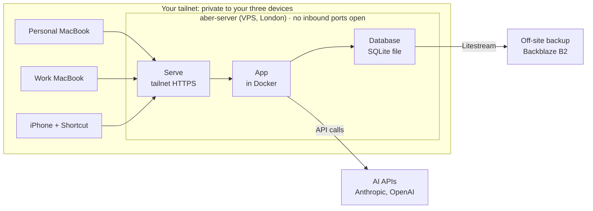

# Aber — Hosting & Tailscale Guide

Oct 31, 2026 · @Maggie Appleton

## Summary

You'll rent a small server in a London data centre that runs the app around the clock. It's reachable **only** from your two MacBooks and your iPhone, through Tailscale. There's no public website, no domain to buy, and no login page facing the internet.



Requests only travel inwards through your tailnet. The server makes outgoing calls to the AI APIs and copies the database to an off-site backup; nothing on the public internet can start a connection to it.

**Recommended setup** (moderate confidence): DigitalOcean server in London, Tailscale for private access, Docker to run the app, Litestream copying the database to Backblaze B2. **About $13–14 a month** all in, before any VAT (breakdown under Costs). **Time:** an afternoon.

**The steps:**

1. Tailscale on your three devices
2. Rent the server
3. Put Tailscale on the server and close every public door
4. Run the app and give it a private HTTPS address
5. Backups
6. iPhone capture

Prices were checked on 31 October 2026. Several changed during 2026, so recheck before you sign up.

## Where to put the app

It needs a computer that's **always on**, so background agents can work overnight, and **always online**, so your phone can reach it from anywhere. Neither MacBook qualifies: laptops sleep and travel.

| Option | Cost | Where | Good | Bad |
| --- | --- | --- | --- | --- |
| **DigitalOcean** Basic Droplet, 1 GiB RAM, 25 GiB disk ([pricing](https://www.digitalocean.com/pricing/droplets)) | $6/mo, plus 20% for weekly backups | London (LON1) is [available](https://docs.digitalocean.com/platform/regional-availability/) | Simple control panel, browser emergency console, one-click resize, in stock | Less RAM per pound than Hetzner; USD billing |
| **Hetzner** CX23, 2 vCPU, 4 GB ([price changes](https://docs.hetzner.com/general/infrastructure-and-availability/price-adjustment/)) | €5.49/mo + €0.50 for an IPv4 address, ex-VAT | Germany or Finland | Most RAM for the money | **Listed as currently unavailable** on [Hetzner's page](https://www.hetzner.com/cloud/cost-optimized/); prices rose twice in 2026; new accounts [may need ID verification](https://docs.hetzner.com/general/security-and-identify/fraud-prevention-faq/) |
| **Fly.io**, 512 MB machine + 1 GB volume ([pricing](https://fly.io/pricing)) | About $3.84/mo (my arithmetic from their rates) | London available | Cheapest; deploys with one command | Apps are public by default. Keeping it Tailscale-only means running Tailscale *inside* the app container, which is noticeably fiddlier |
| **Railway** Hobby ([pricing](https://railway.com/pricing)) | $5/mo including $5 usage; likely $5–8 | Region choice varies | Very easy deploys | Same public-by-default problem as Fly; usage-based bills are harder to predict |
| **Mac mini at home** | About £899 one-off for the current base model (from third-party listings; not confirmed on apple.com/uk) | Your house | No monthly fee; plenty of power | Big upfront cost; goes down with home power or broadband; lives on your home network |

### Recommendation: DigitalOcean, London, $6 plan

Moderate confidence. It's the option where the guide's steps work as written, the server is in stock today, it's close to you, and there's a browser console to rescue you if you lock yourself out.

- **Is 1 GiB enough?** Probably, for one person and a few agents making API calls (moderate confidence). The heavy work happens at Anthropic and OpenAI, not on your server. Step 2 adds a swap file as a safety margin.
- **If it struggles**, for example when building the app: resize to the $12 plan (2 GiB) from the control panel. It takes a few minutes and keeps your data.
- **Switch to Hetzner later** if its cheap servers come back in stock and you want more headroom per pound. The steps are almost identical.

## Estimated costs

### Running costs (monthly, USD, before VAT)

| Service | What it's for | Monthly | Source |
| --- | --- | --- | --- |
| Tailscale Personal | Private network for your devices | $0 | [pricing](https://tailscale.com/pricing) |
| DigitalOcean Droplet, 1 GiB, London | The server | $6.00 | [pricing](https://www.digitalocean.com/pricing/droplets) |
| DigitalOcean weekly backups | Whole-server snapshot, 20% of server price | $1.20 | same page |
| Backblaze B2 | Off-site database copy | $0 (first 10 GB free) | [pricing](https://www.backblaze.com/cloud-storage/pricing) |
| Domain name | Not needed: Tailscale provides the address | $0 | — |
| Apple Shortcuts | iPhone capture | $0 | — |
| **Fixed subtotal** |  | **$7.20** |  |
| Claude Sonnet 5.5 | Processing dumps | $3.60 | [Claude pricing](https://platform.claude.com/docs/en/about-claude/pricing) |
| Claude Haiku 5.5 | Overnight agents | $1.35 | same page |
| OpenAI transcription | Voice dumps | $0.90–$1.80 | [OpenAI pricing](https://developers.openai.com/api/docs/pricing) |
| OpenAI embeddings | Similarity for clustering and linking | about $0.01 | [model page](https://developers.openai.com/api/docs/models/text-embedding-3-small) |
| **AI subtotal** |  | **$5.86–$6.76** |  |
| **Total** |  | **about $13–14** |  |

**VAT.** DigitalOcean [says it applies taxes in some countries](https://www.digitalocean.com/pricing/droplets). Expect UK VAT on top of the server cost (not confirmed for your account; check at sign-up).

### How the AI estimate was worked out

These usage assumptions are guesses; your real usage decides the bill.

| Line | Assumption | Arithmetic | Cost |
| --- | --- | --- | --- |
| Dump processing | 60 dumps a month, \~15k tokens in and \~3k out each | 0.9M × $2 + 0.18M × $10 | $3.60 |
| Overnight jobs | 30 nights, \~300k tokens in and \~30k out per night, each request under 100k tokens | 9M × $0.10 + 0.9M × $0.50 | $1.35 |
| Transcription | 300 minutes a month | 300 × $0.003 (`gpt-4o-mini-transcribe`) to 300 × $0.006 (`gpt-4o-transcribe`) | $0.90–$1.80 |
| Embeddings | 3,000 signals × \~100 tokens | 0.3M × $0.02 | $0.006 |

The Claude prices were checked against Anthropic's pricing page on 31 Oct 2026. The transcription per-minute figures are OpenAI's estimates for token-priced models.

### Three things that change the AI bill

1. **Haiku's 100k cliff.** Haiku 5.5 costs five times more per token when a single request exceeds 100,000 tokens. If the overnight jobs send one giant prompt instead of several smaller ones, that line rises from $1.35 to about $6.75, and the total to about $20. Ask your coding agent to keep each request under 100k.
2. **Batch discount.** Anthropic's Batch API is 50% off. Overnight jobs don't need instant answers, so they're natural candidates.
3. **Spending limits.** Set a monthly cap in both the Anthropic and OpenAI consoles before connecting the app, so a looping agent can't surprise you.

### One-off costs

None are required. If you later prefer a home server, a Mac mini starts at around £899 (third-party listings; not confirmed on Apple's UK store).

## Step 1: Set up Tailscale on your three devices

Tailscale makes your devices behave as if they're on one private network, wherever they are. Nothing outside that network can see the app.

**Time:** about 15 minutes. **Cost:** free. The [Personal plan](https://tailscale.com/pricing) is free, for up to 6 users and unlimited user devices.

### 1a. Create the account

1. Go to [tailscale.com](https://tailscale.com) and choose **Get started**.
2. Sign in with a **personal** identity (a personal Google, Apple or GitHub account), not your work account. This network is yours, and you don't want it tied to an employer login.
3. Skip any "invite teammates" prompts.

### 1b. Install on each MacBook

1. Install Tailscale from the Mac App Store, or from [tailscale.com/download](https://tailscale.com/download).
2. Open it, choose **Log in**, and sign in with the same account.
3. Allow the VPN configuration when macOS asks.

> **Work laptop check** (moderate confidence this matters): company-managed Macs sometimes block VPN apps or already run a corporate VPN that conflicts with Tailscale. Check your employer's policy before installing it there. If it's not allowed, use the app from your personal laptop and phone only.

### 1c. Install on the iPhone

1. Install **Tailscale** from the App Store.
2. Sign in with the same account.
3. Tap **Allow** when iOS asks to add a VPN configuration.

### 1d. Check it worked

Open the [Machines page](https://login.tailscale.com/admin/machines) in the admin console. You should see all three devices, each with a `100.x.x.x` address. That's your private network, called a **tailnet**.

### 1e. Two settings to switch on now

In the admin console's **DNS** page:

1. **MagicDNS** → Enable. Devices get names instead of numbers.
2. **HTTPS Certificates** → Enable. The app can then use a proper `https://` address, which iPhone Shortcuts and browsers prefer.

Both are [required for serving the app](https://tailscale.com/docs/use-cases/application-testing/share-local-dev-server-with-team) and are on by default for new tailnets.

> **Naming caution:** turning on HTTPS [publishes machine names and your tailnet name in public certificate logs](https://tailscale.com/kb/1153/enabling-https). Give machines neutral names, such as `aber-server` rather than something revealing.

The default access policy already lets all your own devices reach each other, so you don't need to edit any access rules ([Tailscale ACL docs](https://tailscale.com/kb/1018/acls)).

## Step 2: Rent the server

**Time:** about 20 minutes. **Cost:** $6/month plus $1.20 for backups. Button labels in DigitalOcean's control panel may differ slightly from these.

### 2a. Make an SSH key on your laptop (if you don't have one)

An SSH key is a pair of files: a private one that stays on your laptop, and a public one you give to the server. It's only used for the very first login; Tailscale SSH replaces it afterwards.

In Terminal, check whether you already have one:

```
ls ~/.ssh/id_ed25519.pub
```

If that says "No such file", create one. Press Enter to accept the default location, and choose a passphrase:

```
ssh-keygen -t ed25519 -C "aber"
```

Copy the public half to your clipboard:

```
pbcopy < ~/.ssh/id_ed25519.pub
```

### 2b. Create the DigitalOcean account

1. Sign up at [digitalocean.com](https://www.digitalocean.com) and add a payment method.
2. Turn on **two-factor authentication** in your account settings. Do the same for every account in this guide: Tailscale's sign-in provider, Backblaze, Anthropic and OpenAI.
3. Set a **billing alert**, for example at $15, so you hear about surprises.

### 2c. Create the server (a "Droplet")

**Create → Droplets**, then:

| Setting | Choose |
| --- | --- |
| Region | **London** (LON1) |
| Image | **Ubuntu**, the newest **LTS** version offered (26.04 if listed, otherwise 24.04) |
| Size | **Basic → Regular**, the **$6/mo** plan (1 GiB RAM, 25 GiB disk) |
| Authentication | **SSH Key → New SSH Key**, paste from your clipboard |
| Backups | **On, weekly** |
| Hostname | `aber-server` |

Click **Create Droplet**. After a minute it shows a **public IPv4 address**. Note it down; Step 3 uses it once and then never again.

### 2d. Add a swap file (after your first login in Step 3a)

Swap is overflow memory on disk. It stops the small server crashing if a build briefly needs more than 1 GiB. Run this once on the server:

```
fallocate -l 2G /swapfile
chmod 600 /swapfile
mkswap /swapfile
swapon /swapfile
echo '/swapfile none swap sw 0 0' >> /etc/fstab
```

The last line keeps it after reboots. Check it with `free -h`; the Swap row should show 2.0Gi.

## Step 3: Put Tailscale on the server and lock it down

After this step the server has **no doors open to the public internet**. Only your three devices can reach it.

**Time:** about 30 minutes. Do the steps in order: the order is what stops you locking yourself out.

### 3a. Log in to the server the first time

On your laptop, open Terminal and run (replace the address with the server's public IP from Step 2):

```
ssh root@203.0.113.10
```

Type `yes` when asked whether to trust the server. You're now typing commands *on the server*.

### 3b. Update it

```
apt update && apt upgrade -y
```

### 3c. Install Tailscale and turn on Tailscale SSH

These commands are from the [Linux install guide](https://tailscale.com/kb/1031/install-linux) and the [CLI reference](https://tailscale.com/kb/1080/cli):

```
curl -fsSL https://tailscale.com/install.sh | sh
tailscale up --ssh
```

The second command prints a link. Open it on your laptop and sign in with **the same personal account** as Step 1. Sign in interactively; don't use an auth key or tag, because the default SSH rule only covers devices you own.

**Tailscale SSH** lets you log in to the server through your tailnet using your Tailscale identity, with no passwords or SSH keys to manage.

### 3d. Tidy the server's entry in the admin console

On the [Machines page](https://login.tailscale.com/admin/machines), click **…** on the server's row:

1. **Edit machine name** → `aber-server` (or another neutral name).
2. **Disable key expiry.** Otherwise the server drops off your tailnet every few months until you re-authenticate it ([key expiry docs](https://tailscale.com/kb/1028/key-expiry)).

### 3e. Prove the private route works before closing the public one

Open a **new** Terminal window on your laptop and run:

```
ssh root@aber-server
```

The [default policy](https://tailscale.com/kb/1193/tailscale-ssh) uses "check mode", so a browser window may ask you to confirm it's you. That's expected, and it may ask again periodically. **Don't continue until this works.**

### 3f. Close the public doors

Two layers: the server's own firewall, then the hosting provider's.

**Server firewall (UFW).** Adapted from [Tailscale's Ubuntu hardening guide](https://tailscale.com/kb/1077/secure-server-ubuntu), reordered so the Tailscale rule exists before anything is blocked. Run these in the Tailscale SSH session from 3e:

```
ufw allow in on tailscale0
ufw default deny incoming
ufw default allow outgoing
ufw enable
ufw status verbose
```

The last line should show incoming denied, with one allow rule on `tailscale0`.

**Provider firewall.** In your host's control panel, create a firewall with **no inbound rules** and attach it to the server. Tailscale [needs no inbound ports](https://tailscale.com/kb/1082/firewall-ports); it connects outwards, and falls back to Tailscale's relays if a direct path isn't possible.

### 3g. Check from outside

From your laptop, try the **public** address again:

```
ssh root@203.0.113.10
```

It should now hang or time out. That's the goal: the only way in is through your tailnet.

> **If you lock yourself out:** every host has a browser-based emergency console in its control panel. Log in there, run `ufw disable`, and redo 3e–3f. Your data isn't affected.

## Step 4: Run the app and give it a private HTTPS address

The app doesn't exist yet, so this step describes the shape. Your coding agent writes the specific files when it builds the app.

### 4a. Install Docker

Docker packages the app and everything it needs into one box that runs the same way everywhere, and restarts it if it crashes. On the server:

```
curl -fsSL https://get.docker.com | sh
```

### 4b. Put the app in a folder

Use `/opt/aber`, with three things in it:

| Item | What it is | Note |
| --- | --- | --- |
| `compose.yaml` | Tells Docker how to run the app | The agent writes this |
| `.env` | Secrets: API keys | **Never commit it to git.** Run `chmod 600 .env` so only root can read it |
| `data/` | The SQLite database file | The only thing you must back up |

The important part of `compose.yaml` looks like this:

```
services:
  app:
    build: .
    restart: unless-stopped
    ports:
      - "127.0.0.1:3000:3000"
    volumes:
      - ./data:/app/data
    env_file: .env
```

> **Why `127.0.0.1:` matters** (high confidence): Docker opens ports with its own firewall rules, which **bypass UFW**. Writing `"3000:3000"` would quietly expose the app to the internet, with only the provider firewall in the way. `127.0.0.1:3000` keeps it reachable only from inside the server itself, where Tailscale picks it up.

Start it:

```
cd /opt/aber
docker compose up -d --build
```

### 4c. Give it an HTTPS address on your tailnet

From [Tailscale Serve](https://tailscale.com/docs/features/tailscale-serve) ([command examples](https://tailscale.com/blog/reintroducing-serve-funnel)):

```
tailscale serve --bg 3000
```

It prints your app's address, in the form `https://aber-server.<your-tailnet-name>.ts.net`. That address:

- works on your MacBooks and iPhone whenever Tailscale is on;
- is invisible to everyone else (Serve is tailnet-only; the public version is a separate command, `funnel`, which you don't want);
- has a real HTTPS certificate, renewed automatically;
- survives reboots, because of `--bg`.

On the iPhone, open it in Safari and choose **Share → Add to Home Screen** for an app-like icon.

### 4d. Shipping updates

The simplest routine (moderate confidence it's the right fit for v1):

1. The code lives in a **private** GitHub repo.
2. On the server, clone it once into `/opt/aber`, using a read-only [deploy key](https://docs.github.com/en/authentication/connecting-to-github-with-ssh/managing-deploy-keys).
3. To update: `cd /opt/aber && git pull && docker compose up -d --build`.

Ask your coding agent to wrap step 3 in a `deploy.sh` script. Your laptop can reach the server through Tailscale SSH, so an agent on your laptop can run the deploy for you.

## Step 5: Backups

Your theories, signals and dumps all live in one SQLite file. Two layers protect it:

| Layer | What it saves | How far back | Protects against |
| --- | --- | --- | --- |
| DigitalOcean weekly backups (switched on in Step 2c) | The whole server | Up to a week old | A broken server, a bad update |
| **Litestream → Backblaze B2** | Just the database, copied continuously | Seconds old | Losing the server, a bad deploy, DigitalOcean itself having a problem |

Weekly server backups alone could lose up to a week of thinking, and they sit with the same company. Litestream is the one that matters.

### 5a. Set up Backblaze B2

1. Create an account at [backblaze.com](https://www.backblaze.com/cloud-storage/pricing) (first 10 GB free; your database will be far smaller).
2. Create a **private** bucket, named something like `aber-backups-` plus a few random letters. Bucket names must be unique across all customers.
3. Create an **application key** restricted to that one bucket. Copy the key ID and key straight into the server's `.env` file; Backblaze shows the key only once.

### 5b. Add Litestream

[Litestream](https://litestream.io/) is a small, actively maintained tool that watches the SQLite file and streams every change to B2. It has a [Backblaze B2 guide](https://litestream.io/guides/). Its repository still labels it beta; it's widely used, but the restore drill below is how you know it works for you.

Ask your coding agent to add Litestream to `compose.yaml` as a second service that shares the `data/` folder, following that guide and reading the keys from `.env`. Then run `docker compose up -d`.

### 5c. The restore drill (do it once now, then quarterly)

A backup you've never restored is a hope, not a backup.

1. Ask your agent to restore the latest Litestream copy **to your laptop**.
2. Open the restored file with a SQLite viewer and check that your most recent dump is in it.
3. Tick the box in the security checklist.

If the drill fails, fix it before putting more thinking into the tool.

## Step 6: Capture from the iPhone

Web apps can't appear in the iPhone share sheet, but an Apple Shortcut can. The Shortcut sends whatever you share to the app's dump endpoint.

### 6a. Make Tailscale connect by itself

Without this, you'd have to remember to switch Tailscale on before every capture.

1. Open the Tailscale app, tap your **profile picture** (top right), then **VPN On Demand**.
2. Turn it on, and set the **Wi-Fi** and **Cellular** rules to **Do Nothing**.
3. Turn on matching for **`*.ts.net`** hostnames.

Hostname matching [only works when the interface rules are "Do Nothing"](https://tailscale.com/kb/1291/ios-vpn-on-demand). The phone will then bring Tailscale up automatically whenever something, such as your Shortcut, tries to reach your `ts.net` address. High confidence the feature exists; **test** that it triggers from a Shortcut specifically.

### 6b. The "Dump" Shortcut

The app needs a dump endpoint first. Ask your coding agent for one: a `POST /api/dumps` that accepts text, URLs or an audio file and stores them immediately.

In the Shortcuts app, build a shortcut with these actions:

1. **Receive** URLs, Text and Files **from Share Sheet**. If there's no input, **Ask For** text, so you can also run it from the home screen.
2. *(Optional)* **Ask for Input**: "Add a note?"
3. **Get Contents of URL**: method **POST**, URL `https://aber-server.<tailnet>.ts.net/api/dumps`, and a body containing the shared item plus the note.
4. **If** the result isn't a success → **Show Alert** "Not saved" and copy the input to the clipboard, so a capture is never lost silently.
5. Otherwise → **Show Notification** "Dumped".

In the shortcut's settings, enable **Show in Share Sheet**. It will then appear when you tap Share in X, Safari or any other app.

### 6c. Voice dumps

| Route | Cost | Trade-off |
| --- | --- | --- |
| Record in **Voice Memos**, share the file to the Dump shortcut; the server transcribes it | About $0.003–$0.006 per minute (see Costs) | Most reliable for long rambles. Keeps the original audio (moderate confidence on sharing audio files from Voice Memos to a Shortcut; test it) |
| Shortcut's **Dictate Text** action | No API fee | Reported to stop after pauses and to cut off long dictation ([Apple Community thread](https://discussions.apple.com/thread/253800615)); not confirmed by Apple. Fine for short notes |
| Record inside the web app | Same as the first row | Needs a recording button in the app; one tap from the home screen icon |

Recommendation (moderate confidence): **Voice Memos → share → Dump** for long thinking-out-loud sessions, typing or pasting in the web app for links plus prose.

## Security checklist and maintenance

### Before you put real thoughts in it

- [ ] Public SSH times out (Step 3g)
- [ ] Provider firewall has no inbound rules, and it's attached to the server
- [ ] `ufw status` shows incoming denied, with an allow rule only on `tailscale0`
- [ ] Docker port is bound to `127.0.0.1` (Step 4b)
- [ ] The app opens on the phone with Tailscale on, and **doesn't** open with Tailscale off and VPN On Demand disabled
- [ ] `.env` is `chmod 600` and not in git
- [ ] Key expiry is disabled for the server only, not for your laptops or phone
- [ ] A backup has been **restored** successfully at least once (Step 5)
- [ ] Spending limits are set on the AI API accounts

### Routine

| When | Task | How |
| --- | --- | --- |
| Automatic | Security updates | Ubuntu's `unattended-upgrades` installs them by default (moderate–high confidence). Check with `systemctl status unattended-upgrades` |
| Automatic | Tailscale updates | The install script added Tailscale's package source, so ordinary updates include it |
| Monthly | Reboot to apply kernel updates | `reboot` over Tailscale SSH; Docker and Serve come back by themselves |
| Monthly | Glance at disk space | `df -h` |
| Quarterly | Practise a restore | See Step 5 |
| Once a year | Read the host's and Tailscale's pricing pages | Prices in this guide were checked on 31 Oct 2026 |

> **A good habit:** ask your coding agent to run the monthly tasks with you over Tailscale SSH and explain what it sees. That's a low-stakes way to build up server confidence.

## Glossary

| Term | Plain meaning |
| --- | --- |
| **Server / VPS** | A computer in a data centre that's always on. A VPS (virtual private server) is a rented slice of a bigger machine |
| **SSH** | Typing commands on another computer from your Terminal |
| **Tailscale SSH** | SSH that goes through your tailnet and uses your Tailscale login instead of passwords or keys |
| **Tailnet** | Your private network of devices on Tailscale. Addresses start with `100.` |
| **MagicDNS** | Gives tailnet devices names (`aber-server`) instead of numbers |
| **Serve** | Tailscale feature that gives an app on the server an `https://…ts.net` address visible only on your tailnet |
| **Funnel** | Serve's public cousin; makes something visible to the whole internet. Not used here |
| **Firewall** | Rules about what traffic may come in. You have two: UFW on the server, and the provider's in its control panel |
| **UFW** | "Uncomplicated Firewall", the server's own firewall |
| **Port** | A numbered door on a computer. The app listens on 3000; SSH normally uses 22 |
| **Docker / container** | A sealed box holding the app and everything it needs, so it runs the same everywhere |
| **Compose** | A file listing how Docker should run the app (ports, folders, secrets) |
| **`.env`** | A file of secrets, such as API keys, read by the app at start-up |
| **Key expiry** | Tailscale makes devices re-log-in periodically. Turned off for the server so it never drops off |
| **Off-site backup** | A copy kept with a different company, so losing the server doesn't lose the data |
| **Litestream** | A small tool that continuously copies a SQLite database to cloud storage |
| **Deploy key** | A key that lets the server read one GitHub repo and nothing else |
